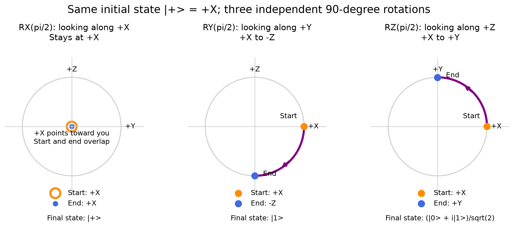

# Qubit visualization

Explore how a qubit state changes under elementary gates.



## Choose an experiment

- [bloch_rotation_comparison.py](bloch_rotation_comparison.py) compares independent RX, RY, and RZ rotations of the same initial state on Bloch spheres.
- [rotation_simple_views.py](rotation_simple_views.py) shows rotations of `|+>` in planar views.
- [hadamard_zero_views.py](hadamard_zero_views.py) compares `|0>` with `H|0>`.
- [qubit_views.ipynb](qubit_views.ipynb) contains short Qiskit and QuTiP experiments. It was previously named `test.ipynb`.

## Run an experiment

Run from the portfolio root.

```powershell
.\.venv\Scripts\python.exe -m pip install -r learning/qubit-visualization/requirements.txt
.\.venv\Scripts\python.exe learning/qubit-visualization/rotation_simple_views.py
```

The Python scripts save figures in the sibling `bloch_rotation_output/` directory and open Matplotlib windows. The notebook saves `circuit.png` relative to its kernel's working directory. Use this folder as the notebook working directory to keep that output here.
