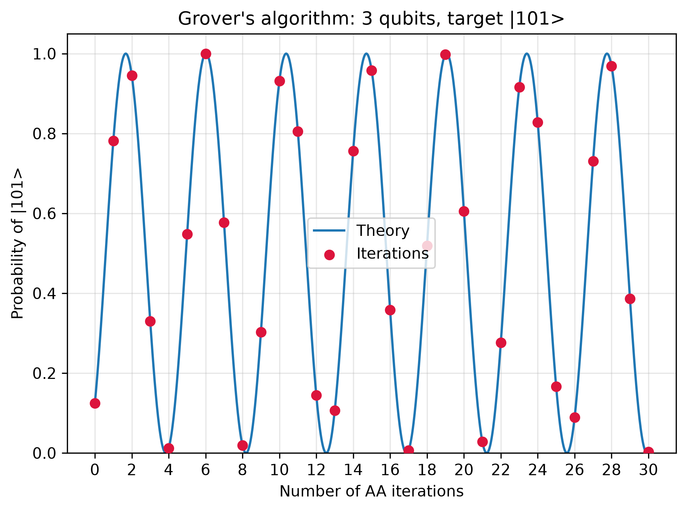

# Grover search and amplitude amplification

Explore how Grover iterations change the probability of measuring a marked state. This project uses a NumPy statevector simulation and Matplotlib plots.



## What the script does

The [script](scripts/grover_probability.py) starts with a uniform superposition over `N = 2**n` basis states. A phase oracle marks one target, and a diffusion operator reflects amplitudes about their mean.

Each iteration applies the oracle followed by diffusion. The script compares the simulated target probability with the analytic expression

\[
P_k = \sin^2((2k+1)\theta), \qquad \theta = \arcsin(1/\sqrt{N}).
\]

The probability oscillates, so adding more iterations does not always improve the chance of finding the target.

`plot_grover` generates probability curves for two and three qubits over 0 through 30 iterations. `plot_shot_distributions` samples the three-qubit state after two iterations, using NumPy's multinomial sampler with seed 42.

This is a classical simulation of the quantum state update. It does not run on quantum hardware or demonstrate a computational speedup.

## Run the script

Run from the `quantum-programming` repository root with Python 3.12 and a virtual environment.

If `.venv` does not exist, create it first.

```powershell
python -m venv .venv
```

Install dependencies and run the script.

```powershell
.\.venv\Scripts\python.exe -m pip install numpy matplotlib
.\.venv\Scripts\python.exe projects/grover/scripts/grover_probability.py
```

The script saves three PNGs in `figures/` beside `scripts/` and opens Matplotlib windows. No Qiskit installation is required.

## Read the figures

| Figure | What to look for |
| --- | --- |
| [Two qubits, target 01](figures/grover_2qubits_01.png) | Simulated probabilities at integer iterations compared with the smooth analytic curve. |
| [Three qubits, target 101](figures/grover_3qubits_101.png) | How changing the search-space size changes the amplification cycle. |
| [Finite-shot distributions](figures/grover_3qubits_101_shot_distributions.png) | Relative frequencies from 1, 10, 100, 1,000, 10,000, and 100,000 shots of the same state. |

The red bars in the shot comparison mark the target state. More shots estimate the existing probability distribution more closely; they do not add Grover iterations.
