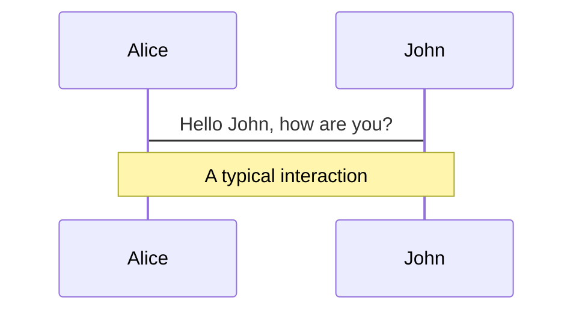
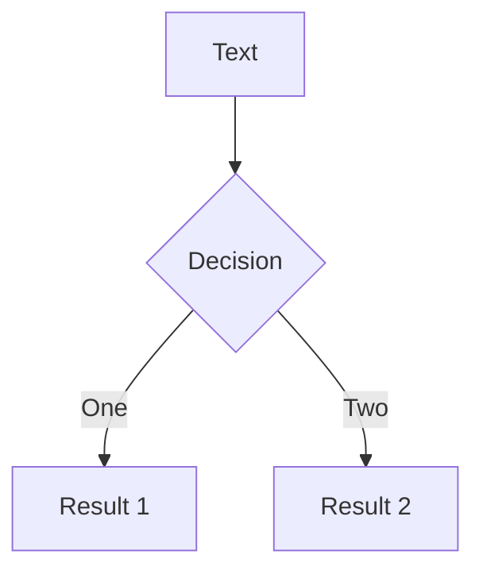
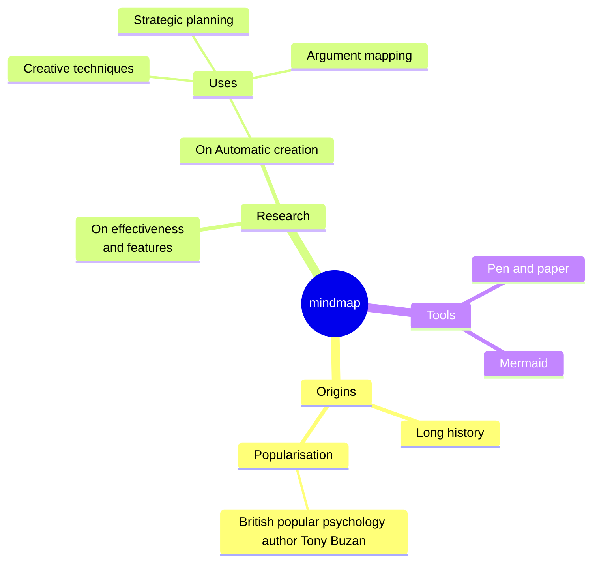
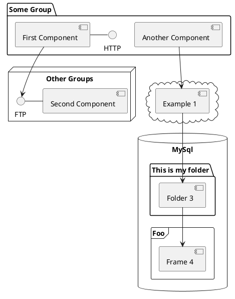

---
# try also 'default' to start simple
theme: seriph
# random image from a curated Unsplash collection by Anthony
# like them? see https://unsplash.com/collections/94734566/slidev
background: https://cover.sli.dev
# some information about your slides (markdown enabled)
title: Welcome to Slidev vv
info: |
  ## Slidev Starter Template
  Presentation slides for developers.

  Learn more at [Sli.dev](https://sli.dev)
# apply UnoCSS classes to the current slide
class: text-center
# https://sli.dev/features/drawing
drawings:
  persist: false
# slide transition: https://sli.dev/guide/animations.html#slide-transitions
transition: slide-left
# enable Comark Syntax: https://comark.dev/syntax/markdown
comark: true
# duration of the presentation
duration: 35min
---

# Welcome to Slidev

Presentation slides for developers

<div @click="$slidev.nav.next" class="mt-12 py-1" hover:bg="white op-10">
  Press Space for next page <carbon:arrow-right />
</div>

<div class="abs-br m-6 text-xl">
  <button @click="$slidev.nav.openInEditor()" title="Open in Editor" class="slidev-icon-btn">
    <carbon:edit />
  </button>
  <a href="https://github.com/slidevjs/slidev" target="_blank" class="slidev-icon-btn">
    <carbon:logo-github />
  </a>
</div>

<!--
The last comment block of each slide will be treated as slide notes. It will be visible and editable in Presenter Mode along with the slide. [Read more in the docs](https://sli.dev/guide/syntax.html#notes)
-->

---
transition: fade-out
---

# What is Slidev vvv?

Slidev is a slides maker and presenter designed for developers, consist of the following features

- 📝 **Text-based** - focus on the content with Markdown, and then style them later
- 🎨 **Themable** - themes can be shared and re-used as npm packages
- 🧑‍💻 **Developer Friendly** - code highlighting, live coding with autocompletion
- 🤹 **Interactive** - embed Vue components to enhance your expressions
- 🎥 **Recording** - built-in recording and camera view
- 📤 **Portable** - export to PDF, PPTX, PNGs, or even a hostable SPA
- 🛠 **Hackable** - virtually anything that's possible on a webpage is possible in Slidev
<br>
<br>

Read more about [Why Slidev?](https://sli.dev/guide/why)

<!--
You can have `style` tag in markdown to override the style for the current page.
Learn more: https://sli.dev/features/slide-scope-style
-->

<style>
h1 {
  background-color: #2B90B6;
  background-image: linear-gradient(45deg, #4EC5D4 10%, #146b8c 20%);
  background-size: 100%;
  -webkit-background-clip: text;
  -moz-background-clip: text;
  -webkit-text-fill-color: transparent;
  -moz-text-fill-color: transparent;
}
</style>

<!--
Here is another comment.
-->

---
transition: slide-up
level: 2
---

# Navigation

Hover on the bottom-left corner to see the navigation's controls panel, [learn more](https://sli.dev/guide/ui#navigation-bar)

## Keyboard Shortcuts

|                                                     |                             |
| --------------------------------------------------- | --------------------------- |
| <kbd>right</kbd> / <kbd>space</kbd>                 | next animation or slide     |
| <kbd>left</kbd>  / <kbd>shift</kbd><kbd>space</kbd> | previous animation or slide |
| <kbd>up</kbd>                                       | previous slide              |
| <kbd>down</kbd>                                     | next slide                  |

<!-- https://sli.dev/guide/animations.html#click-animation -->

<p v-after class="absolute bottom-23 left-45 opacity-30 transform -rotate-10">Here!</p>

---
layout: two-cols
layoutClass: gap-16
---

# Table of contents

You can use the `Toc` component to generate a table of contents for your slides:

```html
<Toc minDepth="1" maxDepth="1" />
```

The title will be inferred from your slide content, or you can override it with `title` and `level` in your frontmatter.

::right::

<Toc text-sm minDepth="1" maxDepth="2" />

---
layout: image-right
image: https://cover.sli.dev
---

# Code

Use code snippets and get the highlighting directly, and even types hover!

```ts [filename-example.ts] {all|4|6|6-7|9|all} twoslash
// TwoSlash enables TypeScript hover information
// and errors in markdown code blocks
// More at https://shiki.style/packages/twoslash
import { computed, ref } from 'vue'

const count = ref(0)
const doubled = computed(() => count.value * 2)

doubled.value = 2
```

<arrow v-click="[4, 5]" x1="350" y1="310" x2="195" y2="342" color="#953" width="2" arrowSize="1" />

<!-- This allow you to embed external code blocks -->
<<< @/snippets/external.ts#snippet

<!-- Footer -->

[Learn more](https://sli.dev/features/line-highlighting)

<!-- Inline style -->
<style>
.footnotes-sep {
  @apply mt-5 opacity-10;
}
.footnotes {
  @apply text-sm opacity-75;
}
.footnote-backref {
  display: none;
}
</style>

<!--
Notes can also sync with clicks

[click] This will be highlighted after the first click

[click] Highlighted with `count = ref(0)`

[click:3] Last click (skip two clicks)
-->

---
level: 2
---

# Shiki Magic Move

Powered by [shiki-magic-move](https://shiki-magic-move.netlify.app/), Slidev supports animations across multiple code snippets.

Add multiple code blocks and wrap them with <code>````md magic-move</code> (four backticks) to enable the magic move. For example:

````md magic-move {lines: true}
```ts {*|2|*}
// step 1
const author = reactive({
  name: 'John Doe',
  books: [
    'Vue 2 - Advanced Guide',
    'Vue 3 - Basic Guide',
    'Vue 4 - The Mystery'
  ]
})
```

```ts {*|1-2|3-4|3-4,8}
// step 2
export default {
  data() {
    return {
      author: {
        name: 'John Doe',
        books: [
          'Vue 2 - Advanced Guide',
          'Vue 3 - Basic Guide',
          'Vue 4 - The Mystery'
        ]
      }
    }
  }
}
```

```ts
// step 3
export default {
  data: () => ({
    author: {
      name: 'John Doe',
      books: [
        'Vue 2 - Advanced Guide',
        'Vue 3 - Basic Guide',
        'Vue 4 - The Mystery'
      ]
    }
  })
}
```

Non-code blocks are ignored.

```vue
<!-- step 4 -->
<script setup>
const author = {
  name: 'John Doe',
  books: [
    'Vue 2 - Advanced Guide',
    'Vue 3 - Basic Guide',
    'Vue 4 - The Mystery'
  ]
}
</script>
```
````

---

# Components

<div grid="~ cols-2 gap-4">
<div>

You can use Vue components directly inside your slides.

We have provided a few built-in components like `<Tweet/>`, `<BlueSky/>`, and `<Youtube/>` that you can use directly. And adding your custom components is also super easy.

```html
<Counter :count="10" />
```

<!-- ./components/Counter.vue -->
<Counter :count="10" m="t-4" />

Check out [the guides](https://sli.dev/builtin/components.html) for more.

</div>
<div>

```html
<Tweet id="1390115482657726468" />
```

<Tweet id="1390115482657726468" scale="0.65" />

</div>
</div>

<!--
Presenter note with **bold**, *italic*, and ~~striked~~ text.

Also, HTML elements are valid:
<div class="flex w-full">
  <span style="flex-grow: 1;">Left content</span>
  <span>Right content</span>
</div>
-->

---
class: px-20
---

# Themes

Slidev comes with powerful theming support. Themes can provide styles, layouts, components, or even configurations for tools. Switching between themes by just **one edit** in your frontmatter:

<div grid="~ cols-2 gap-2" m="t-2">

```yaml
---
theme: default
---
```

```yaml
---
theme: seriph
---
```


</div>

Read more about [How to use a theme](https://sli.dev/guide/theme-addon#use-theme) and
check out the [Awesome Themes Gallery](https://sli.dev/resources/theme-gallery).

---

# Clicks Animations

You can add `v-click` to elements to add a click animation.

<div v-click>

This shows up when you press <kbd>space</kbd> or <kbd>right</kbd>, or click outside the slide on the right.

```html
<div v-click>This shows up when you trigger a click animation.</div>
```

</div>

<p v-click>
You can also add modifiers to change the animation:
</p>

<div class="grid gap-3 mt-4 text-sm" style="grid-template-columns: repeat(3, 1fr) 1.5fr 1fr">
  <div v-after.up class="p-3 rounded border border-primary/20 bg-primary/10">
    <div class="font-mono text-xs opacity-60 mb-1">v-click.up</div>
    <div>Slide from bottom</div>
  </div>
  <div v-click.fade-in class="p-3 rounded border border-primary/30 bg-primary/15">
    <div class="font-mono text-xs opacity-60 mb-1">v-click.fade-in</div>
    <div>Fade in</div>
  </div>
  <div v-click.fade class="p-3 rounded border border-primary/40 bg-primary/20">
    <div class="font-mono text-xs opacity-60 mb-1">v-click.fade</div>
    <div>Dim (0.5 opacity)</div>
  </div>
  <div v-click.fade.right.scale class="p-3 rounded border border-primary/50 bg-primary/25">
    <div class="font-mono text-xs opacity-60 mb-1">v-click.fade.right.scale</div>
    <div>Composed</div>
  </div>
  <div v-click.none class="p-3 rounded border border-primary/60 bg-primary/30">
    <div class="font-mono text-xs opacity-60 mb-1">v-click.none</div>
    <div>No transition</div>
  </div>
</div>

<v-click>

The <span v-mark.red="7"><code>v-mark</code> directive</span>
also allows you to add
<span v-mark.circle.orange="8">inline marks</span>
, powered by [Rough Notation](https://roughnotation.com/):

```html
<span v-mark.underline.orange>inline markers</span>
```

</v-click>

<div v-click mt-12>

[Learn more](https://sli.dev/guide/animations#click-animation)

</div>

---

# Motions

Motion animations are powered by [@vueuse/motion](https://motion.vueuse.org/), triggered by `v-motion` directive.

```html
<div
  v-motion
  :initial="{ x: -80 }"
  :enter="{ x: 0 }"
  :click-3="{ x: 80 }"
  :leave="{ x: 1000 }"
>
  Slidev
</div>
```

<div class="w-60 relative">
  <div class="relative w-40 h-40">
    
    
    
  </div>

  <div
    class="text-5xl absolute top-14 left-40 text-[#2B90B6] -z-1"
    v-motion
    :initial="{ x: -80, opacity: 0}"
    :enter="{ x: 0, opacity: 1, transition: { delay: 2000, duration: 1000 } }">
    Slidev
  </div>
</div>

<!-- vue script setup scripts can be directly used in markdown, and will only affects current page -->
<script setup lang="ts">
const final = {
  x: 0,
  y: 0,
  rotate: 0,
  scale: 1,
  transition: {
    type: 'spring',
    damping: 10,
    stiffness: 20,
    mass: 2
  }
}
</script>

<div
  v-motion
  :initial="{ x:35, y: 30, opacity: 0}"
  :enter="{ y: 0, opacity: 1, transition: { delay: 3500 } }">

[Learn more](https://sli.dev/guide/animations.html#motion)

</div>

---

# $\LaTeX$

$\LaTeX$ is supported out-of-box. Powered by [$\KaTeX$](https://katex.org/).

<div h-3 />

Inline $\sqrt{3x-1}+(1+x)^2$

Block
$$ {1|3|all}
\begin{aligned}
\nabla \cdot \vec{E} &= \frac{\rho}{\varepsilon_0} \\
\nabla \cdot \vec{B} &= 0 \\
\nabla \times \vec{E} &= -\frac{\partial\vec{B}}{\partial t} \\
\nabla \times \vec{B} &= \mu_0\vec{J} + \mu_0\varepsilon_0\frac{\partial\vec{E}}{\partial t}
\end{aligned}
$$

[Learn more](https://sli.dev/features/latex)

---
layout: center
class: quantum-state-slide
transition: fade-out
---

# The Quantum State of One Qubit

<p class="subtitle">One state — two complex amplitudes</p>

<div class="state-equation">

$$
|\psi\rangle = \alpha|0\rangle + \beta|1\rangle,
\qquad \alpha,\beta \in \mathbb{C}
$$

</div>

<div class="property-grid">

<div v-click.up.fade-in class="property-card complex-card">
  <div class="property-label">COMPLEX AMPLITUDE</div>

$$
\alpha = a+bi, \qquad \beta = c+di,
\qquad a,b,c,d\in\mathbb{R}
$$

  <p>Magnitude and phase together determine the state.</p>
</div>

<div v-click.up.fade-in class="property-card norm-card">
  <div class="property-label">NORMALIZATION</div>

$$
\langle\psi|\psi\rangle
= |\alpha|^2 + |\beta|^2 = 1
$$

  <p>The probabilities of all measurement outcomes must sum to 1.</p>
</div>

</div>

<div v-click.up.fade-in class="measurement-row">
  <span>Measure in the computational basis</span>
  <span class="outcome"><b>0</b> with P(0) = |α|²</span>
  <span class="plus">+</span>
  <span class="outcome"><b>1</b> with P(1) = |β|²</span>
  <span class="equals">= 1</span>
</div>

<style>
.quantum-state-slide {
  background:
    radial-gradient(circle at 82% 18%, rgba(124, 58, 237, 0.16), transparent 28%),
    radial-gradient(circle at 14% 88%, rgba(6, 182, 212, 0.14), transparent 32%),
    #080b18;
  color: #eef2ff;
}
.quantum-state-slide h1 {
  margin-bottom: 0;
  text-align: center;
  font-size: 2.1rem;
  letter-spacing: -0.02em;
  background: linear-gradient(90deg, #67e8f9, #c4b5fd);
  background-clip: text;
  -webkit-background-clip: text;
  color: transparent;
}
.quantum-state-slide .subtitle {
  margin: 0.25rem 0 1rem;
  text-align: center;
  color: #94a3b8;
}
.state-equation {
  margin: 0 auto 1.1rem;
  padding: 0.7rem 1.5rem;
  width: 78%;
  border: 1px solid rgba(103, 232, 249, 0.28);
  border-radius: 1rem;
  background: rgba(15, 23, 42, 0.72);
  box-shadow: 0 0 40px rgba(34, 211, 238, 0.08);
  font-size: 1.25rem;
}
.property-grid {
  display: grid;
  grid-template-columns: 1fr 1fr;
  gap: 1rem;
}
.property-card {
  min-height: 8.6rem;
  padding: 1rem 1.2rem;
  border-radius: 0.9rem;
  background: rgba(15, 23, 42, 0.78);
}
.complex-card { border-top: 3px solid #22d3ee; }
.norm-card { border-top: 3px solid #a78bfa; }
.property-label {
  font-family: ui-monospace, SFMono-Regular, Menlo, monospace;
  font-size: 0.68rem;
  letter-spacing: 0.12em;
  color: #94a3b8;
}
.property-card .katex-display { margin: 0.55rem 0; }
.property-card p {
  margin: 0;
  font-size: 0.82rem;
  color: #cbd5e1;
}
.measurement-row {
  display: flex;
  align-items: center;
  justify-content: center;
  gap: 0.65rem;
  margin-top: 1rem;
  font-size: 0.8rem;
  color: #cbd5e1;
}
.quantum-state-slide .slidev-vclick-target {
  transition:
    opacity 650ms cubic-bezier(0.22, 1, 0.36, 1),
    translate 650ms cubic-bezier(0.22, 1, 0.36, 1);
}
.outcome {
  padding: 0.4rem 0.65rem;
  border: 1px solid rgba(148, 163, 184, 0.25);
  border-radius: 0.6rem;
  background: rgba(30, 41, 59, 0.8);
}
.outcome b { color: #67e8f9; }
.plus { color: #64748b; }
.equals { color: #c4b5fd; font-size: 1rem; }
</style>

<!--
Reveal in sequence: complex amplitudes → normalization → measurement probabilities.
The amplitudes alpha and beta are not probabilities; square their magnitudes.
-->

---
layout: two-cols
layoutClass: gap-10
class: bloch-slide
transition: slide-left
---

# From a Qubit to the Bloch Sphere

<p class="bloch-lead">Ignoring the unobservable global phase, every pure one-qubit state becomes a point on the sphere.</p>

<div class="bloch-state">

$$
|\psi\rangle =
\cos\!\left(\frac{\theta}{2}\right)|0\rangle
+ e^{i\phi}\sin\!\left(\frac{\theta}{2}\right)|1\rangle
$$

</div>

<div v-click class="angle-card">
  <div><span>θ</span> polar angle</div>
  <small>0 ≤ θ ≤ π</small>
  <div><span>φ</span> relative phase</div>
  <small>0 ≤ φ &lt; 2π</small>
</div>

<div v-click class="coordinates">

$$
\vec r =
\begin{pmatrix}x\\y\\z\end{pmatrix}
=
\begin{pmatrix}
\sin\theta\cos\phi\\
\sin\theta\sin\phi\\
\cos\theta
\end{pmatrix},
\qquad \|\vec r\|=1
$$

</div>

::right::

<div class="sphere-wrap">
<svg viewBox="0 0 520 470" role="img" aria-label="Bloch sphere showing a qubit state vector">
  <defs>
    <radialGradient id="sphereFill" cx="35%" cy="25%" r="72%">
      <stop offset="0%" stop-color="#67e8f9" stop-opacity="0.22" />
      <stop offset="58%" stop-color="#6366f1" stop-opacity="0.11" />
      <stop offset="100%" stop-color="#111827" stop-opacity="0.08" />
    </radialGradient>
    <linearGradient id="stateVector" x1="0" y1="1" x2="1" y2="0">
      <stop offset="0%" stop-color="#22d3ee" />
      <stop offset="100%" stop-color="#f0abfc" />
    </linearGradient>
    <filter id="pointGlow" x="-200%" y="-200%" width="400%" height="400%">
      <feGaussianBlur stdDeviation="5" result="blur" />
      <feMerge><feMergeNode in="blur"/><feMergeNode in="SourceGraphic"/></feMerge>
    </filter>
    <marker id="axisArrow" viewBox="0 0 10 10" refX="8" refY="5" markerWidth="5" markerHeight="5" orient="auto-start-reverse">
      <path d="M 0 0 L 10 5 L 0 10 z" fill="#64748b" />
    </marker>
    <marker id="vectorArrow" viewBox="0 0 10 10" refX="8" refY="5" markerWidth="7" markerHeight="7" orient="auto-start-reverse">
      <path d="M 0 0 L 10 5 L 0 10 z" fill="#f0abfc" />
    </marker>
    <clipPath id="sphereClip"><circle cx="260" cy="225" r="160" /></clipPath>
  </defs>

  <circle cx="260" cy="225" r="160" fill="url(#sphereFill)" stroke="#818cf8" stroke-width="2" />

  <g clip-path="url(#sphereClip)" fill="none">
    <ellipse cx="260" cy="225" rx="160" ry="48" stroke="#67e8f9" stroke-opacity="0.6" stroke-width="1.5" />
    <ellipse cx="260" cy="225" rx="160" ry="48" transform="rotate(90 260 225)" stroke="#818cf8" stroke-opacity="0.38" />
    <ellipse cx="260" cy="225" rx="160" ry="48" transform="rotate(-38 260 225)" stroke="#818cf8" stroke-opacity="0.28" />
    <ellipse cx="260" cy="225" rx="160" ry="48" transform="rotate(38 260 225)" stroke="#818cf8" stroke-opacity="0.28" />
    <ellipse cx="260" cy="180" rx="150" ry="34" stroke="#818cf8" stroke-opacity="0.18" />
    <ellipse cx="260" cy="270" rx="150" ry="34" stroke="#818cf8" stroke-opacity="0.18" />
  </g>

  <g stroke="#64748b" stroke-width="1.5" marker-end="url(#axisArrow)">
    <line x1="260" y1="405" x2="260" y2="38" />
    <line x1="105" y1="285" x2="430" y2="168" />
    <line x1="104" y1="169" x2="426" y2="294" />
  </g>

  <g fill="#94a3b8" font-size="17" font-family="ui-monospace, monospace">
    <text x="270" y="43">z</text>
    <text x="438" y="166">x</text>
    <text x="434" y="307">y</text>
  </g>

  <text x="278" y="76" fill="#e0e7ff" font-size="18">|0⟩</text>
  <text x="278" y="397" fill="#e0e7ff" font-size="18">|1⟩</text>
  <text x="270" y="244" fill="#94a3b8" font-size="14">O</text>

  <line x1="260" y1="225" x2="354" y2="104" stroke="url(#stateVector)" stroke-width="5" marker-end="url(#vectorArrow)" />
  <line x1="354" y1="104" x2="354" y2="260" stroke="#f0abfc" stroke-opacity="0.35" stroke-dasharray="5 6" />
  <line x1="260" y1="225" x2="354" y2="260" stroke="#f0abfc" stroke-opacity="0.35" stroke-dasharray="5 6" />
  <circle cx="354" cy="104" r="7" fill="#f0abfc" filter="url(#pointGlow)" />
  <text x="368" y="98" fill="#f5d0fe" font-size="18">|ψ⟩</text>

  <path d="M260 164 Q283 164 300 174" fill="none" stroke="#fbbf24" stroke-width="2" />
  <text x="286" y="155" fill="#fbbf24" font-size="18">θ</text>
  <path d="M310 244 Q332 249 349 260" fill="none" stroke="#34d399" stroke-width="2" />
  <text x="335" y="240" fill="#34d399" font-size="18">φ</text>
</svg>

<div v-click class="sphere-caption">
  <span>north <b>|0⟩</b></span>
  <span>equator <b>superposition</b></span>
  <span>south <b>|1⟩</b></span>
</div>
</div>

<style>
.bloch-slide {
  background:
    radial-gradient(circle at 75% 45%, rgba(99, 102, 241, 0.16), transparent 33%),
    #080b18;
  color: #eef2ff;
}
.bloch-slide h1 {
  margin-bottom: 0.35rem;
  font-size: 2rem;
  background: linear-gradient(90deg, #67e8f9, #c4b5fd);
  background-clip: text;
  -webkit-background-clip: text;
  color: transparent;
}
.bloch-lead {
  max-width: 95%;
  margin-top: 0;
  color: #94a3b8;
  font-size: 0.9rem;
  line-height: 1.55;
}
.bloch-state {
  margin-top: 1.1rem;
  padding: 0.65rem 0.8rem;
  border-left: 3px solid #22d3ee;
  border-radius: 0 0.7rem 0.7rem 0;
  background: rgba(15, 23, 42, 0.76);
  font-size: 0.92rem;
}
.bloch-state .katex-display { margin: 0.35rem 0; }
.angle-card {
  display: grid;
  grid-template-columns: 1fr auto;
  gap: 0.3rem 0.8rem;
  margin-top: 1rem;
  padding: 0.7rem 0.9rem;
  border: 1px solid rgba(148, 163, 184, 0.2);
  border-radius: 0.7rem;
  background: rgba(15, 23, 42, 0.56);
  font-size: 0.78rem;
  color: #cbd5e1;
}
.angle-card span { color: #fbbf24; font-size: 1rem; }
.angle-card small { color: #64748b; }
.coordinates {
  margin-top: 0.75rem;
  font-size: 0.76rem;
  color: #c4b5fd;
}
.coordinates .katex-display { margin: 0.25rem 0; }
.sphere-wrap {
  position: relative;
  height: 100%;
  display: flex;
  flex-direction: column;
  justify-content: center;
  align-items: center;
}
.sphere-wrap svg {
  width: 100%;
  max-height: 26rem;
  overflow: visible;
}
.sphere-caption {
  display: flex;
  gap: 0.55rem;
  margin-top: -0.7rem;
  font-size: 0.65rem;
  color: #94a3b8;
}
.sphere-caption span {
  padding: 0.3rem 0.5rem;
  border-radius: 99px;
  background: rgba(30, 41, 59, 0.8);
}
.sphere-caption b { color: #e0e7ff; }
</style>

<!--
The Bloch sphere represents pure states of one qubit.
Surface points have vector length 1; mixed states live inside the sphere.
-->

---

layout: center
class: bell-circuit-slide
transition: slide-up
---

# Building a Bell State

<p class="bell-lead">Start with two independent qubits in <b>|00⟩</b>, then apply a Hadamard and a CNOT.</p>

<div class="circuit-card">
<div class="circuit-label">QUANTUM CIRCUIT</div>
<svg viewBox="0 0 760 300" role="img" aria-label="Quantum circuit that creates a Bell state">
<defs>
<linearGradient id="bellWire" x1="0" y1="0" x2="1" y2="0">
<stop offset="0%" stop-color="#22d3ee" />
<stop offset="100%" stop-color="#a78bfa" />
</linearGradient>
<filter id="bellGlow" x="-100%" y="-100%" width="300%" height="300%">
<feGaussianBlur stdDeviation="4" result="blur" />
<feMerge><feMergeNode in="blur"/><feMergeNode in="SourceGraphic"/></feMerge>
</filter>
</defs>

<text x="28" y="92" class="wire-label">q₀</text>
<text x="28" y="222" class="wire-label">q₁</text>
<text x="76" y="92" class="state-label">|0⟩</text>
<text x="76" y="222" class="state-label">|0⟩</text>

<line x1="120" y1="84" x2="680" y2="84" class="wire" />
<line x1="120" y1="214" x2="680" y2="214" class="wire" />

<text x="214" y="34" class="operation-label">create superposition</text>
<rect x="235" y="52" width="64" height="64" rx="12" class="gate" />
<text x="267" y="94" text-anchor="middle" class="gate-text">H</text>

<text x="438" y="34" class="operation-label">entangle</text>
<line x1="470" y1="84" x2="470" y2="214" class="connector" />
<circle cx="470" cy="84" r="11" class="control" />
<circle cx="470" cy="214" r="25" class="target" />
<line x1="454" y1="214" x2="486" y2="214" class="target-mark" />
<line x1="470" y1="198" x2="470" y2="230" class="target-mark" />

<text x="696" y="92" class="state-label">|0⟩</text>
<text x="696" y="222" class="state-label">|0⟩</text>
<text x="635" y="273" class="output-label">Bell pair: |Φ⁺⟩</text>
</svg>
</div>

<div class="operation-notes">
  <div v-click.up.fade-in class="operation-note">
    <span class="operation-number">1</span>
    <div><b>Hadamard H</b><small>puts q₀ into an equal superposition</small></div>
  </div>
  <div v-click.up.fade-in class="operation-note">
    <span class="operation-number">2</span>
    <div><b>CNOT</b><small>copies the control’s value into q₁</small></div>
  </div>
</div>

<div v-click.up.fade-in class="bell-equation">

$$
|00\rangle
\xrightarrow{H\otimes I}
\frac{|00\rangle+|10\rangle}{\sqrt{2}}
\xrightarrow{\mathrm{CNOT}}
\boxed{|\Phi^+\rangle
=\frac{|00\rangle+|11\rangle}{\sqrt{2}}}
$$

</div>

<style>
.bell-circuit-slide {
  background:
    radial-gradient(circle at 18% 18%, rgba(34, 211, 238, 0.14), transparent 30%),
    radial-gradient(circle at 84% 76%, rgba(167, 139, 250, 0.15), transparent 34%),
    #080b18;
  color: #eef2ff;
}
.bell-circuit-slide h1 {
  margin-bottom: 0.25rem;
  font-size: 2.05rem;
  background: linear-gradient(90deg, #67e8f9, #c4b5fd);
  background-clip: text;
  -webkit-background-clip: text;
  color: transparent;
}
.bell-lead {
  margin: 0 0 1rem;
  color: #94a3b8;
  font-size: 0.9rem;
  text-align: center;
}
.bell-lead b { color: #e0e7ff; }
.circuit-card {
  width: 100%;
  padding: 0.7rem 0.8rem 0.4rem;
  border: 1px solid rgba(103, 232, 249, 0.25);
  border-radius: 0.95rem;
  background: rgba(15, 23, 42, 0.76);
  box-shadow: 0 0 45px rgba(34, 211, 238, 0.06);
}
.circuit-label {
  margin: 0 0 0.2rem 0.4rem;
  color: #64748b;
  font: 0.62rem ui-monospace, SFMono-Regular, Menlo, monospace;
  letter-spacing: 0.14em;
}
.circuit-card svg {
  display: block;
  width: 100%;
  height: auto;
}
.wire {
  stroke: url(#bellWire);
  stroke-width: 3;
  stroke-linecap: round;
}
.wire-label {
  fill: #67e8f9;
  font: 700 19px ui-monospace, SFMono-Regular, Menlo, monospace;
}
.state-label {
  fill: #cbd5e1;
  font: 20px Georgia, serif;
}
.operation-label {
  fill: #94a3b8;
  font: 14px ui-monospace, SFMono-Regular, Menlo, monospace;
  text-anchor: middle;
}
.gate {
  fill: rgba(34, 211, 238, 0.15);
  stroke: #67e8f9;
  stroke-width: 2;
}
.gate-text {
  fill: #e0f2fe;
  font: 700 31px Georgia, serif;
}
.connector {
  stroke: #c4b5fd;
  stroke-width: 3;
}
.control {
  fill: #c4b5fd;
  filter: url(#bellGlow);
}
.target {
  fill: rgba(167, 139, 250, 0.16);
  stroke: #c4b5fd;
  stroke-width: 3;
}
.target-mark {
  stroke: #e9d5ff;
  stroke-width: 3;
  stroke-linecap: round;
}
.output-label {
  fill: #f0abfc;
  font: 16px ui-monospace, SFMono-Regular, Menlo, monospace;
  text-anchor: middle;
}
.operation-notes {
  display: grid;
  grid-template-columns: 1fr 1fr;
  gap: 0.8rem;
  width: 100%;
  margin-top: 0.8rem;
}
.operation-note {
  display: flex;
  align-items: center;
  gap: 0.6rem;
  padding: 0.6rem 0.75rem;
  border: 1px solid rgba(148, 163, 184, 0.18);
  border-radius: 0.7rem;
  background: rgba(15, 23, 42, 0.7);
}
.operation-number {
  display: inline-flex;
  width: 1.5rem;
  height: 1.5rem;
  align-items: center;
  justify-content: center;
  border-radius: 50%;
  background: rgba(34, 211, 238, 0.2);
  color: #67e8f9;
  font-weight: 700;
}
.operation-note b {
  display: block;
  color: #e0e7ff;
  font-size: 0.78rem;
}
.operation-note small {
  display: block;
  margin-top: 0.18rem;
  color: #94a3b8;
  font-size: 0.65rem;
}
.bell-equation {
  margin-top: 0.85rem;
  color: #c4b5fd;
  font-size: 0.9rem;
}
.bell-equation .katex-display { margin: 0.25rem 0; }
.bell-circuit-slide .slidev-vclick-target {
  transition:
    opacity 550ms cubic-bezier(0.22, 1, 0.36, 1),
    translate 550ms cubic-bezier(0.22, 1, 0.36, 1);
}
</style>

<!--
The circuit prepares |Φ⁺⟩, one of the four Bell states.
Click to reveal the role of H, then CNOT, then the final state equation.
-->

---

layout: center
class: linear-search-slide
transition: slide-up
---

# Linear Search: Check One Position at a Time

<p class="search-lead">Task: find <span class="target-pill">target = 4</span> in an array, scanning from left to right.</p>

<div class="search-demo">
  <div class="array-row">
    <div class="index-row">
      <span>index</span><span>0</span><span>1</span><span>2</span><span>3</span><span>4</span>
    </div>
    <div class="array-cells">
      <div class="cell"><span class="value">7</span><span v-click="1" class="scan-badge no">≠ 4</span></div>
      <div class="cell"><span class="value">2</span><span v-click="2" class="scan-badge no">≠ 4</span></div>
      <div class="cell"><span class="value">9</span><span v-click="3" class="scan-badge no">≠ 4</span></div>
      <div class="cell found-cell"><span class="value">4</span><span v-click="4" class="scan-badge yes">= 4 ✓</span></div>
      <div class="cell untouched"><span class="value">6</span></div>
    </div>
  </div>

  <div class="step-track">
    <div v-click="1" class="step"><span class="step-number">1</span> Compare <b>7</b> with <b>4</b> → no match</div>
    <div v-click="2" class="step"><span class="step-number">2</span> Compare <b>2</b> with <b>4</b> → no match</div>
    <div v-click="3" class="step"><span class="step-number">3</span> Compare <b>9</b> with <b>4</b> → no match</div>
    <div v-click="4" class="step found-step"><span class="step-number">4</span> Found at <b>index = 3</b> → stop</div>
  </div>
</div>

<div class="search-bottom">
  <div class="pseudo-box">
    <div class="code-label">PSEUDOCODE</div>

```text
for i = 0 .. n-1:
  if A[i] == target: return i
return -1
```

  </div>
  <div class="complexity-box">
    <div class="code-label">COMPLEXITY</div>
    <div class="complexity-main">O(n)</div>
    <div class="complexity-note">worst case: inspect every cell</div>
  </div>
</div>

<style>
.linear-search-slide {
  background:
    radial-gradient(circle at 18% 15%, rgba(34, 211, 238, 0.13), transparent 30%),
    radial-gradient(circle at 85% 80%, rgba(167, 139, 250, 0.13), transparent 32%),
    #080b18;
  color: #eef2ff;
}
.linear-search-slide h1 {
  margin-bottom: 0.25rem;
  font-size: 2.05rem;
  background: linear-gradient(90deg, #67e8f9, #c4b5fd);
  background-clip: text;
  -webkit-background-clip: text;
  color: transparent;
}
.search-lead {
  margin: 0 0 1.2rem;
  color: #94a3b8;
  font-size: 0.92rem;
}
.target-pill {
  display: inline-block;
  padding: 0.15rem 0.55rem;
  border: 1px solid rgba(251, 191, 36, 0.5);
  border-radius: 99px;
  color: #fbbf24;
  background: rgba(120, 53, 15, 0.3);
}
.search-demo {
  display: grid;
  grid-template-columns: 1.25fr 1fr;
  gap: 1.35rem;
  width: 100%;
  align-items: center;
}
.array-row { min-width: 0; }
.index-row, .array-cells {
  display: grid;
  grid-template-columns: 0.75fr repeat(5, 1fr);
  gap: 0.45rem;
  align-items: center;
}
.index-row {
  margin-bottom: 0.35rem;
  color: #64748b;
  font: 0.68rem ui-monospace, SFMono-Regular, Menlo, monospace;
  text-align: center;
}
.index-row span:first-child { text-align: left; }
.array-cells { position: relative; }
.array-cells::before {
  content: 'A[i]';
  align-self: center;
  color: #64748b;
  font: 0.68rem ui-monospace, SFMono-Regular, Menlo, monospace;
}
.cell {
  position: relative;
  display: flex;
  min-height: 5.7rem;
  align-items: center;
  justify-content: center;
  border: 1px solid rgba(103, 232, 249, 0.45);
  border-radius: 0.8rem;
  background: rgba(15, 23, 42, 0.82);
  box-shadow: inset 0 -10px 25px rgba(34, 211, 238, 0.04);
}
.cell .value {
  font-size: 2rem;
  font-weight: 700;
  color: #e0f2fe;
}
.found-cell {
  border-color: rgba(251, 191, 36, 0.75);
  background: rgba(120, 53, 15, 0.25);
}
.untouched { opacity: 0.38; }
.scan-badge {
  position: absolute;
  right: 0.25rem;
  bottom: 0.28rem;
  padding: 0.15rem 0.3rem;
  border-radius: 0.3rem;
  font: 0.58rem ui-monospace, SFMono-Regular, Menlo, monospace;
}
.scan-badge.no { color: #94a3b8; background: rgba(51, 65, 85, 0.65); }
.scan-badge.yes { color: #fcd34d; background: rgba(146, 64, 14, 0.65); }
.step-track {
  display: flex;
  flex-direction: column;
  gap: 0.43rem;
}
.step {
  padding: 0.55rem 0.7rem;
  border-left: 3px solid #334155;
  border-radius: 0 0.55rem 0.55rem 0;
  background: rgba(15, 23, 42, 0.72);
  color: #cbd5e1;
  font-size: 0.76rem;
}
.step-number {
  display: inline-flex;
  width: 1.25rem;
  height: 1.25rem;
  align-items: center;
  justify-content: center;
  margin-right: 0.35rem;
  border-radius: 50%;
  background: #334155;
  color: #e2e8f0;
  font-size: 0.65rem;
}
.found-step { border-left-color: #fbbf24; color: #fde68a; }
.found-step .step-number { background: #b45309; }
.search-bottom {
  display: grid;
  grid-template-columns: 1.45fr 0.55fr;
  gap: 1rem;
  width: 100%;
  margin-top: 1.2rem;
}
.pseudo-box, .complexity-box {
  padding: 0.7rem 0.9rem;
  border: 1px solid rgba(148, 163, 184, 0.18);
  border-radius: 0.7rem;
  background: rgba(15, 23, 42, 0.68);
}
.code-label {
  margin-bottom: 0.3rem;
  color: #64748b;
  font: 0.62rem ui-monospace, SFMono-Regular, Menlo, monospace;
  letter-spacing: 0.13em;
}
.pseudo-box pre { margin: 0; font-size: 0.64rem; line-height: 1.35; }
.complexity-box { text-align: center; }
.complexity-main { color: #67e8f9; font: 2rem Georgia, serif; }
.complexity-note { color: #94a3b8; font-size: 0.65rem; }
</style>

<!--
Press each step to demonstrate linear search: each v-click is one comparison.
-->

---

layout: center
class: magic-search-slide
transition: fade
---

# Shiki Magic Move: Change the Target

<p class="magic-lead">Press <kbd>right</kbd> to morph the same linear-search code from <span>4</span> → <span>8</span> → <span>32</span>.</p>

<div class="magic-layout">
  <div class="magic-code-panel">
    <div class="code-label">THE SEARCH TRACE</div>

````md magic-move {lines: true}
```ts
const data = [4, 8, 16, 32]
const target = 4

// checks: 1
// found at index: 0
```
```ts
const data = [4, 8, 16, 32]
const target = 8

// checks: 2
// found at index: 1
```
```ts
const data = [4, 8, 16, 32]
const target = 32

// checks: 4
// found at index: 3
```
````
  </div>

  <div class="magic-side">
    <div class="magic-kicker">CLASSICAL QUERY COUNT</div>
    <div class="target-ladder">
      <div class="target-step"><strong>4</strong><span>1 comparison</span></div>
      <div class="target-step"><strong>8</strong><span>2 comparisons</span></div>
      <div class="target-step last"><strong>32</strong><span>4 comparisons</span></div>
    </div>
    <p>Every step asks the same question:</p>
    <div class="query-card">“Is this the item I want?”</div>
    <div class="baseline-note">Classical baseline: <b>O(n)</b> queries</div>
  </div>
</div>

<p class="magic-footer">This is the baseline we will improve on with Grover’s algorithm.</p>

<style>
.magic-search-slide {
  background:
    radial-gradient(circle at 18% 20%, rgba(34, 211, 238, 0.13), transparent 30%),
    radial-gradient(circle at 84% 78%, rgba(167, 139, 250, 0.14), transparent 33%),
    #080b18;
  color: #eef2ff;
}
.magic-search-slide h1 {
  margin-bottom: 0.25rem;
  font-size: 2.05rem;
  background: linear-gradient(90deg, #67e8f9, #c4b5fd);
  background-clip: text;
  -webkit-background-clip: text;
  color: transparent;
}
.magic-lead {
  margin: 0 0 1.15rem;
  color: #94a3b8;
  font-size: 0.9rem;
}
.magic-lead span { color: #fbbf24; font-weight: 700; }
.magic-lead kbd {
  padding: 0.1rem 0.35rem;
  border: 1px solid rgba(148, 163, 184, 0.28);
  border-radius: 0.3rem;
  color: #e2e8f0;
  font-size: 0.72rem;
}
.magic-layout {
  display: grid;
  grid-template-columns: 1.35fr 0.65fr;
  gap: 1.25rem;
  width: 100%;
  align-items: stretch;
}
.magic-code-panel, .magic-side {
  padding: 0.85rem 1rem;
  border: 1px solid rgba(148, 163, 184, 0.2);
  border-radius: 0.9rem;
  background: rgba(15, 23, 42, 0.76);
}
.magic-code-panel pre {
  margin: 0;
  min-height: 12.2rem;
  font-size: 0.79rem;
  line-height: 1.45;
}
.magic-kicker, .code-label {
  margin-bottom: 0.5rem;
  color: #64748b;
  font: 0.62rem ui-monospace, SFMono-Regular, Menlo, monospace;
  letter-spacing: 0.13em;
}
.magic-side {
  display: flex;
  flex-direction: column;
  justify-content: center;
}
.target-ladder {
  display: flex;
  flex-direction: column;
  gap: 0.5rem;
}
.target-step {
  display: flex;
  align-items: baseline;
  justify-content: space-between;
  padding: 0.55rem 0.7rem;
  border-left: 3px solid #22d3ee;
  border-radius: 0 0.5rem 0.5rem 0;
  background: rgba(30, 41, 59, 0.72);
}
.target-step strong { color: #67e8f9; font-size: 1.25rem; }
.target-step span { color: #cbd5e1; font-size: 0.72rem; }
.target-step:nth-child(2) { border-left-color: #a78bfa; }
.target-step:nth-child(2) strong { color: #c4b5fd; }
.target-step.last { border-left-color: #fbbf24; }
.target-step.last strong { color: #fcd34d; }
.magic-side p {
  margin: 1rem 0 0.45rem;
  color: #94a3b8;
  font-size: 0.76rem;
}
.query-card {
  padding: 0.6rem 0.7rem;
  border: 1px dashed rgba(251, 191, 36, 0.45);
  border-radius: 0.55rem;
  color: #fde68a;
  background: rgba(120, 53, 15, 0.18);
  font-size: 0.78rem;
}
.baseline-note {
  margin-top: 0.8rem;
  color: #94a3b8;
  font-size: 0.72rem;
}
.baseline-note b { color: #67e8f9; }
.magic-footer {
  margin: 1rem 0 0;
  color: #c4b5fd;
  font-size: 0.78rem;
  text-align: center;
}
</style>

<!--
Magic Move morphs the code block on each click:
target 4 → target 8 → target 32.
-->

---

# Diagrams

You can create diagrams / graphs from textual descriptions, directly in your Markdown.

<div class="grid grid-cols-4 gap-5 pt-4 -mb-6">









</div>

Learn more: [Mermaid Diagrams](https://sli.dev/features/mermaid) and [PlantUML Diagrams](https://sli.dev/features/plantuml)

---
foo: bar
dragPos:
  square: 691,32,167,_,-16
---

# Draggable Elements

Double-click on the draggable elements to edit their positions.

<br>

###### Directive Usage

```md

```

<br>

###### Component Usage

```md
<v-drag text-3xl>
  <div class="i-carbon:arrow-up" />
  Use the `v-drag` component to have a draggable container!
</v-drag>
```

<v-drag pos="655,216,261,_,-15">
  <div text-center text-3xl border border-main rounded>
    Double-click me!
  </div>
</v-drag>


###### Draggable Arrow

```md
<v-drag-arrow two-way />
```

<v-drag-arrow pos="67,452,253,46" two-way op70 />

---
src: ./pages/imported-slides.md
hide: false
---

---

# Monaco Editor

Slidev provides built-in Monaco Editor support.

Add `{monaco}` to the code block to turn it into an editor:

```ts {monaco}
import { ref } from 'vue'
import { emptyArray } from './external'

const arr = ref(emptyArray(10))
```

Use `{monaco-run}` to create an editor that can execute the code directly in the slide:

```ts {monaco-run}
import { version } from 'vue'
import { emptyArray, sayHello } from './external'

sayHello()
console.log(`vue ${version}`)
console.log(emptyArray<number>(10).reduce(fib => [...fib, fib.at(-1)! + fib.at(-2)!], [1, 1]))
```

---
layout: center
class: text-center
---

# Learn More

[Documentation](https://sli.dev) · [GitHub](https://github.com/slidevjs/slidev) · [Showcases](https://sli.dev/resources/showcases)

<PoweredBySlidev mt-10 />
