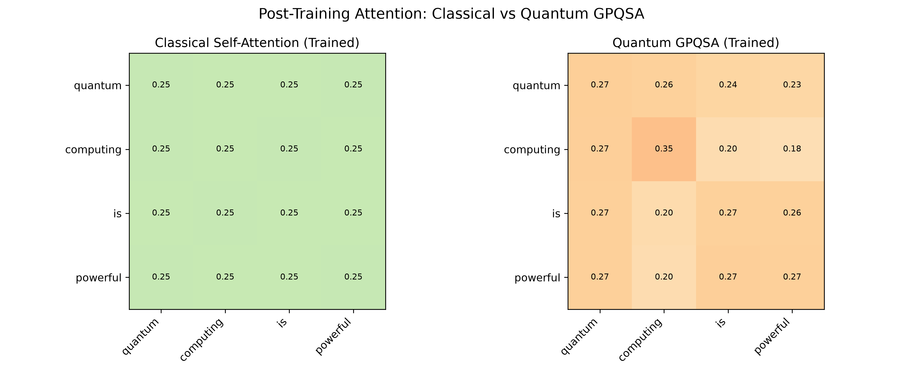

# Quantum self-attention

A small demonstration of quantum self-attention alongside a classical attention baseline. PennyLane computes quantum quantities and gradients. Qiskit draws the query and value circuits.



The implementation follows ideas from [Quantum Self-Attention Neural Networks for Text Classification](https://arxiv.org/abs/2205.05625). It uses four fixed toy token embeddings and two qubits. It is not a reproduction of the paper's full text-classification benchmark.

## Explore the implementation

- [qsann_demo.py](scripts/qsann_demo.py) contains the classical baseline, quantum circuits, attention weights, and a toy training loop.
- [Query circuit](figures/qsann_circuit_query.png) illustrates the query measurement.
- [Value circuit](figures/qsann_circuit_value.png) illustrates the value measurements.
- [Circuit depth guide](qsann_depth_guide.md) explains the encoder and ansatz depths in Thai.
- [Quantum operations guide](quantum_operations_guide.md) connects gates and attention concepts in Thai.

The `generate_*` and `draw_enhanced_circuits.py` scripts create additional explanatory diagrams. All script output paths resolve to this project's `figures/` directory.

## Run the demo

Run from the portfolio root.

```powershell
.\.venv\Scripts\python.exe -m pip install -r projects/quantum-self-attention/requirements.txt
.\.venv\Scripts\python.exe -X utf8 projects/quantum-self-attention/scripts/qsann_demo.py
```

PennyLane is required for computation. Qiskit and `pylatexenc` support circuit drawings. The existing sample figures are retained; the relocated scripts have not been rerun as part of this reorganization.

## Reading material

The primary source is [arXiv:2205.05625v2](https://arxiv.org/abs/2205.05625v2). [Quantum Adaptive Self-Attention for Quantum Transformer Models](https://arxiv.org/abs/2504.05336v1) is additional reading, not the implementation target of this demo.

Local PDFs and extracted paper material remain in `references/`, which is excluded from the portfolio's Git tracking. Source links above remain available to readers who clone the repository.
