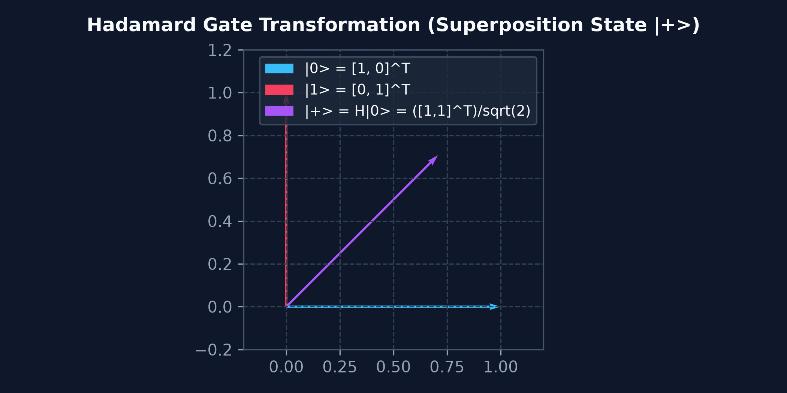
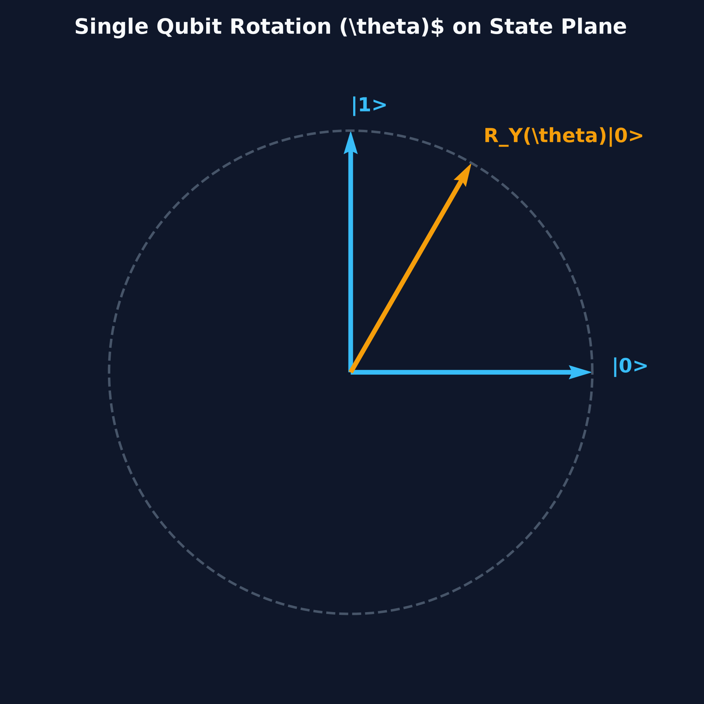
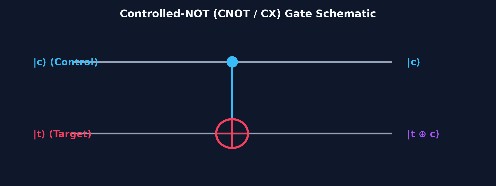
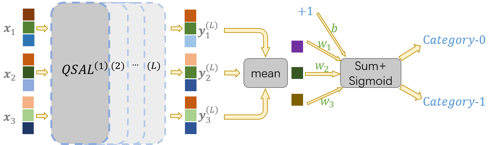
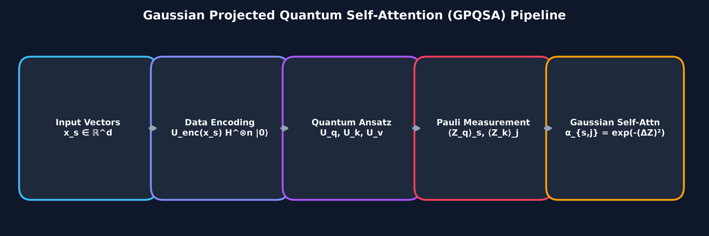
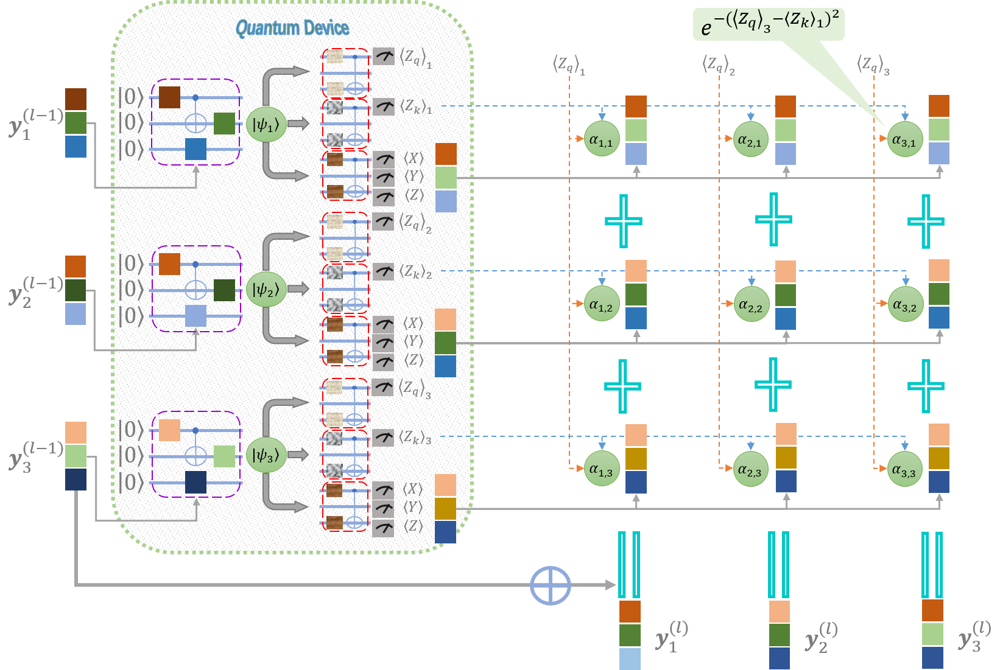

# คู่มืออธิบาย Quantum Operations ในเปเปอร์ QSANN (arXiv:2205.05625v2)
> **สำหรับผู้เรียนระดับปูพื้นฐาน (~10% Quantum Background)**  
> **อ้างอิงหลัก**: เปเปอร์ arXiv:2205.05625v2, หนังสือ *Introduction to Classical and Quantum Computing* (Thomas G. Wong) และ *Programming Quantum Computers* (Eric R. Johnston et al.)

---

## 📌 สารบัญ (Table of Contents)
1. [ปูพื้นฐานเวกเตอร์ คิวบิต และ สัญลักษณ์ (Quantum Basics & Notation)](#1-ปูพื้นฐานเวกเตอร์-คิวบิต-และ-สัญลักษณ์)
2. [Hadamard Gate ($H$) — ประตูสร้าง Superposition](#2-hadamard-gate-h--ประตูสร้าง-superposition)
3. [Single-Qubit Rotation Gates ($R_X, R_Y, R_Z$) — ประตูหมุนเวกเตอร์](#3-single-qubit-rotation-gates-r_x-r_y-r_z--ประตูหมุนเวกเตอร์)
4. [CNOT Gate (Controlled-NOT / CX) — ประตูผูกพันควอนตัม (Entangled Gate)](#4-cnot-gate-controlled-not--cx--ประตูผูกพันควอนตัม)
5. [Pauli Observables ($X, Y, Z$) & Measurement Expectation Value — การวัดค่าและความคาดหวัง](#5-pauli-observables-x-y-z--measurement-expectation-value)
6. [Parameterized Quantum Circuit (Ansatz $U(\theta)$) — วงจรควอนตัมเรียนรู้ได้](#6-parameterized-quantum-circuit-ansatz-utheta)
7. [Gaussian Projected Quantum Self-Attention (GPQSA) — กลไก Self-Attention ควอนตัม](#7-gaussian-projected-quantum-self-attention-gpqsa)
   - [7.1 Intuition & Paper Contribution](#71-intuition--paper-contribution-นวัตกรรมของเปเปอร์)
   - [7.2 สมการสรุปการทำงานเต็มของ GPQSA (Eq. 3–7)](#72-สมการสรุปการทำงานเต็มของ-gpqsa-eq-37-ในเปเปอร์)
   - [7.3 Layer Stacking — การซ้อน QSAL หลายชั้น (Eq. 9)](#73-layer-stacking--การซ้อน-qsal-หลายชั้น-eq-9-ในเปเปอร์)
   - [7.4 Prediction Head — Average Pooling, FC Layer & Loss (Eq. 8)](#74-prediction-head--average-pooling-fully-connected-layer--loss-function-eq-8-ในเปเปอร์)
8. [ตารางสรุป Quick Reference Cheat Sheet](#8-ตารางสรุป-quick-reference-cheat-sheet)

---

## 1. ปูพื้นฐานเวกเตอร์ คิวบิต และ สัญลักษณ์

ก่อนเข้าสู่เปเปอร์ เราต้องทำความเข้าใจสัญลักษณ์ทางควอนตัม (Dirac Bra-Ket Notation) และการแทนค่าด้วยเวกเตอร์/เมทริกซ์เบื้องต้นก่อนครับ

### 1.1 Qubit State (สถานะคิวบิต)
ในคอมพิวเตอร์คลาสสิก บิตมีค่าได้แค่ $0$ หรือ $1$ แต่ในควอนตัม คิวบิตเป็น **เวกเตอร์ความน่าจะเป็น (Vector State)** ขนาด 2 มิติ:

$$|0\rangle = \begin{pmatrix} 1 \\ 0 \end{pmatrix}, \quad |1\rangle = \begin{pmatrix} 0 \\ 1 \end{pmatrix}$$

สถานะทั่วไป $|\psi\rangle$ สามารถอยู่รวมกันได้ (Superposition):
$$|\psi\rangle = \alpha |0\rangle + \beta |1\rangle = \begin{pmatrix} \alpha \\ \beta \end{pmatrix}$$
โดยที่ $\alpha, \beta \in \mathbb{C}$ เป็นความน่าจะเป็นแอมพลิจูด (Probability Amplitudes) ซึ่งต้องสอดคล้องกับกฎ $|\alpha|^2 + |\beta|^2 = 1$

### 1.2 Bra-Ket Notation (สัญลักษณ์ บรา-เคท)
- **Ket $|\psi\rangle$**: เวกเตอร์คอลัมน์ (Column Vector)
- **Bra $\langle \psi |$**: เวกเตอร์แถวที่เป็น Conjugate Transpose ($|\psi\rangle^\dagger$)

$$\text{ถ้า } |\psi\rangle = \begin{pmatrix} \alpha \\ \beta \end{pmatrix} \implies \langle \psi | = \begin{pmatrix} \alpha^* & \beta^* \end{pmatrix}$$

- **Inner Product (ผลคูณภายใน) $\langle \phi | \psi \rangle$**: ได้ผลลัพธ์เป็น **ตัวเลขสเกลาร์ (Scalar)** ใช้หาความคล้ายคลึง/ความน่าจะเป็น
- **Outer Product (ผลคูณภายนอก) $|\psi\rangle\langle \phi|$**: ได้ผลลัพธ์เป็น **เมทริกซ์ (Operator)**

### 1.3 Multi-Qubit & Tensor Product ($\otimes$)
เมื่อมีคิวบิตหลายตัว (เช่น $n$ qubits) สถานะควอนตัมจะถูกคูณกันด้วย **Tensor Product ($\otimes$)**:

$$|00\rangle = |0\rangle \otimes |0\rangle = \begin{pmatrix} 1 \\ 0 \end{pmatrix} \otimes \begin{pmatrix} 1 \\ 0 \end{pmatrix} = \begin{pmatrix} 1 \cdot \begin{pmatrix} 1 \\ 0 \end{pmatrix} \\[4pt] 0 \cdot \begin{pmatrix} 1 \\ 0 \end{pmatrix} \end{pmatrix} = \begin{pmatrix} 1 \\ 0 \\ 0 \\ 0 \end{pmatrix}$$

---

## 2. Hadamard Gate ($H$) — ประตูสร้าง Superposition



### 2.1 Intuition (มโนทัศน์)
ประตู **Hadamard ($H$)** คือประตูพื้นฐานที่สุดในการทำควอนตัมประมวลผล หน้าที่ของมันคือการสลับฐานการคำนวณ (Computational Basis) จากจุดแน่นอน $|0\rangle$ หรือ $|1\rangle$ ให้กลายเป็นการซ้อนทับกัน **(Superposition)** ที่มีโอกาสวัดพบ $0$ และ $1$ อย่างละ 50% เท่ากัน

### 2.2 Mathematical Definition (สมการคณิตศาสตร์)
เมทริกซ์ยูนิแทรี (Unitary Matrix) ของ Hadamard Gate ขนาด $2 \times 2$ คือ:

$$H = \frac{1}{\sqrt{2}} \begin{pmatrix} 1 & 1 \\ 1 & -1 \end{pmatrix}$$

**การแปลงสถานะ (State Transformation):**
$$H|0\rangle = \frac{1}{\sqrt{2}} \begin{pmatrix} 1 & 1 \\ 1 & -1 \end{pmatrix} \begin{pmatrix} 1 \\ 0 \end{pmatrix} = \frac{1}{\sqrt{2}} \begin{pmatrix} 1 \\ 1 \end{pmatrix} = \frac{|0\rangle + |1\rangle}{\sqrt{2}} \equiv |+\rangle$$

$$H|1\rangle = \frac{1}{\sqrt{2}} \begin{pmatrix} 1 & 1 \\ 1 & -1 \end{pmatrix} \begin{pmatrix} 0 \\ 1 \end{pmatrix} = \frac{1}{\sqrt{2}} \begin{pmatrix} 1 \\ -1 \end{pmatrix} = \frac{|0\rangle - |1\rangle}{\sqrt{2}} \equiv |-\rangle$$

**ตัวอย่างการคำนวณ: H ทำงานกับ |0>**
```
H|0> = (1/sqrt(2)) * [[1, 1], [1, -1]] × [1, 0]^T
     = (1/1.4142) × [(1×1 + 1×0), (1×1 + (-1)×0)]^T
     = (1/1.4142) × [1, 1]^T
     = [0.7071, 0.7071]^T

ความน่าจะเป็นวัดพบ |0> = |0.7071|^2 = 0.5  (50%)
ความน่าจะเป็นวัดพบ |1> = |0.7071|^2 = 0.5  (50%)
```

สำหรับคิวบิต $n$ ตัว การใส่ $H^{\otimes n}$ ให้กับสถานะตั้งต้น $|0^n\rangle = |00\dots 0\rangle$ จะสร้างสถานะ Superposition แบบสม่ำเสมอทุกสถานะย่อย $2^n$ สถานะ:

$$H^{\otimes n} |0^n\rangle = \frac{1}{\sqrt{2^n}} \sum_{x \in \{0,1\}^n} |x\rangle$$

### 2.3 บทบาทในเปเปอร์ QSANN (arXiv:2205.05625v2)
ในสมการที่ (3) ของเปเปอร์:
$$|\psi_s\rangle = U_{\text{enc}}(y_s^{(l-1)}) H^{\otimes n} |0^n\rangle$$
 Hadamard Gate ($H^{\otimes n}$) ถูกนำมาใช้กระจายสถานะเริ่มต้น $|0^n\rangle$ ให้ปกคลุมทั่วควอนตัมฮิลเบิร์ตสเปซ (Hilbert Space) ก่อนที่จะนำเวกเตอร์คำ $y_s$ เข้าไปแปลงมุมหมุนในขั้นตอน Data Encoding $U_{\text{enc}}$

---

## 3. Single-Qubit Rotation Gates ($R_X, R_Y, R_Z$) — ประตูหมุนเวกเตอร์



### 3.1 Intuition (มโนทัศน์)
สถานะของคิวบิตสามารถมองเป็นจุดบนทรงกลม **Bloch Sphere** ประตูหมุน $R_X(\theta), R_Y(\theta), R_Z(\theta)$ คือการหมุนเวกเตอร์สถานะนั้นรอบแกน X, Y หรือ Z ด้วยมุม $\theta$ (ราเดียน) ประตูเหล่านี้ถูกใช้เป็น **น้ำหนักที่เรียนรู้ได้ (Trainable Parameters)** ในโมเดล Machine Learning เหมือนกับ Weights ใน Neural Network

### 3.2 Mathematical Definition (สมการคณิตศาสตร์)
ประตูหมุนกำเนิดมาจากเมทริกซ์พอลี (Pauli Matrices) ผ่านฟังก์ชัน Matrix Exponential:

$$R_P(\theta) = \exp\left(-i \frac{\theta}{2} P\right) = \cos\left(\frac{\theta}{2}\right) I - i \sin\left(\frac{\theta}{2}\right) P \quad (P \in \{X, Y, Z\})$$

#### 1) ประตูหมุนแกน X ($R_X$):
$$R_X(\theta) = \begin{pmatrix} \cos\frac{\theta}{2} & -i\sin\frac{\theta}{2} \\[4pt] -i\sin\frac{\theta}{2} & \cos\frac{\theta}{2} \end{pmatrix}$$

**ตัวอย่างการคำนวณ: R_X(pi/2) ทำงานกับ |0>**
```
theta = pi/2, theta/2 = pi/4
cos(pi/4) = 0.7071,  sin(pi/4) = 0.7071

R_X(pi/2)|0> = [[0.7071, -0.7071i], [-0.7071i, 0.7071]] × [1, 0]^T
             = [0.7071, -0.7071i]^T

ความน่าจะเป็นวัดพบ |0> = |0.7071|^2     = 0.5   (50%)
ความน่าจะเป็นวัดพบ |1> = |-0.7071i|^2   = 0.5   (50%)
→ สังเกต: ได้ superposition แต่มี phase ซ้อนมิติจินตภาพ (imaginary)
```

#### 2) ประตูหมุนแกน Y ($R_Y$):
$$R_Y(\theta) = \begin{pmatrix} \cos\frac{\theta}{2} & -\sin\frac{\theta}{2} \\[4pt] \sin\frac{\theta}{2} & \cos\frac{\theta}{2} \end{pmatrix}$$

> **ข้อสังเกตสำคัญ**: $R_Y(\theta)$ ใช้เฉพาะจำนวนจริง (Real numbers) ไม่มีตัวไอจินตภาพ $i$ จึงนิยมใช้แปลงข้อมูลคลาสสิกเข้าสู่ควอนตัมเวกเตอร์โดยตรง!

**ตัวอย่างการคำนวณ: R_Y(pi/3) ทำงานกับ |0>**
```
theta = pi/3 (60 องศา), theta/2 = pi/6 (30 องศา)
cos(pi/6) = 0.8660,  sin(pi/6) = 0.5000

R_Y(pi/3)|0> = [[0.8660, -0.5000], [0.5000, 0.8660]] × [1, 0]^T
             = [0.8660, 0.5000]^T

ความน่าจะเป็นวัดพบ |0> = |0.8660|^2 = 0.75   (75%)
ความน่าจะเป็นวัดพบ |1> = |0.5000|^2 = 0.25   (25%)
→ สังเกต: ไม่มี i เลย (จำนวนจริงเพียว!) ข้อมูลคลาสสิกจึงใช้เป็นมุม theta ได้โดยตรง
```

#### 3) ประตูหมุนแกน Z ($R_Z$):
$$R_Z(\theta) = \begin{pmatrix} e^{-i\theta/2} & 0 \\[4pt] 0 & e^{i\theta/2} \end{pmatrix}$$

> ⚠️ **หมายเหตุ**: ประตู $R_Z$ ถูกกล่าวถึงเพื่อความครบถ้วนเท่านั้น — ในเปเปอร์ QSANN (arXiv:2205.05625v2) **ไม่มีการใช้งาน $R_Z$** ทั้งในวงจร FIG. 2 และในสมการใดๆ ใช้เฉพาะ $R_X$ และ $R_Y$ เท่านั้น

### 3.3 บทบาทในเปเปอร์ QSANN (arXiv:2205.05625v2)
จาก **รูปที่ 2 (FIG. 2)** ในเปเปอร์:
1. **Data Encoding ($U_{\text{enc}}$)**: นำเอาฟีเจอร์เวกเตอร์คลาสสิก $y_s \in \mathbb{R}^d$ ป้อนเป็นมุม $\theta$ ให้กับประตู $R_X(\theta)$ และ $R_Y(\theta)$ เพื่อแปลงข้อมูลคำให้อยู่ในรูปสถานะควอนตัม
2. **Trainable Ansatz ($U_q, U_k, U_v$)**: ใช้ประตู $R_X(\theta_i)$ และ $R_Y(\theta_j)$ เป็นพารามิเตอร์ของ Query, Key, Value ที่ถูกอัปเดตค่าด้วย Gradient Descent ( Backpropagation)

---

## 4. CNOT Gate (Controlled-NOT / CX) — ประตูผูกพันควอนตัม



### 4.1 Intuition (มโนทัศน์)
**CNOT Gate** เป็นประตู 2 คิวบิต ประกอบด้วย:
- **Control Qubit ($|c\rangle$)**: คิวบิตควบคุม
- **Target Qubit ($|t\rangle$)**: คิวบิตเป้าหมาย

กฎการทำงาน:  
- ถ้า Control Qubit เป็น $|0\rangle \implies$ Target Qubit **ไม่เปลี่ยนแปลง**
- ถ้า Control Qubit เป็น $|1\rangle \implies$ Target Qubit ถูก **NOT (กลับจาก $0 \leftrightarrow 1$)**

CNOT คือประตูสำคัญในการสร้าง **ควอนตัมเอ็นแทงเกิลเมนต์ (Quantum Entanglement)** หรือความผูกพันเชิงสถิติระหว่างคิวบิตสองตัวที่ไม่สามารถแยกคิดเดี่ยวๆ ได้

### 4.2 Mathematical Definition (สมการคณิตศาสตร์)
เมทริกซ์ของ CNOT Gate ขนาด $4 \times 4$ บนฐาน $\{|00\rangle, |01\rangle, |10\rangle, |11\rangle\}$ คือ:

$$\text{CNOT} = \begin{pmatrix} 
1 & 0 & 0 & 0 \\ 
0 & 1 & 0 & 0 \\ 
0 & 0 & 0 & 1 \\ 
0 & 0 & 1 & 0 
\end{pmatrix}$$

**การทำงานเชิงสัญลักษณ์:**
$$\text{CNOT} |c, t\rangle = |c, t \oplus c\rangle \quad (\oplus \text{ คือการบวกแบบ Modulo 2 / XOR})$$

**ตัวอย่างการคำนวณ: CNOT ทำงานกับทุกสถานะ basis**
```
CNOT |00> = |0, 0 XOR 0> = |00>   (control=0 → target ไม่เปลี่ยน)
CNOT |01> = |0, 1 XOR 0> = |01>   (control=0 → target ไม่เปลี่ยน)
CNOT |10> = |1, 0 XOR 1> = |11>   (control=1 → target ถูก NOT!)
CNOT |11> = |1, 1 XOR 1> = |10>   (control=1 → target ถูก NOT!)
```

**การสร้าง Bell State (สถานะผูกพันสมบูรณ์):**
$$\text{CNOT} \left( H|0\rangle \otimes |0\rangle \right) = \text{CNOT} \left( \frac{|00\rangle + |10\rangle}{\sqrt{2}} \right) = \frac{|00\rangle + |11\rangle}{\sqrt{2}} \equiv |\Phi^+\rangle$$

### 4.3 บทบาทในเปเปอร์ QSANN (arXiv:2205.05625v2)
ในวงจร **Strongly Entangled Ansatz (FIG. 2)**:
CNOT Gate ถูกเชื่อมต่อในลักษณะวงแหวน (Ring pattern / Chain) จากคิวบิตที่ $i$ ไปยังคิวบิตที่ $i+1$ เพื่อส่งผ่านและผสมผสานข้อมูลความสัมพันธ์ระหว่างมิติต่างๆ ของเวกเตอร์คำในระบบ

---

## 5. Pauli Observables ($X, Y, Z$) & Measurement Expectation Value

### 5.1 Intuition (มโนทัศน์)
ระบบควอนตัมไม่สามารถอ่านค่าสถานะตรงๆ ได้ ต้องผ่านขั้นตอน **การวัดค่า (Quantum Measurement)** ซึ่งการวัดค่าจะได้ผลลัพธ์เป็นตัวเลขคลาสสิกแบบสถิติเรียกว่า **ค่าความคาดหวัง (Expectation Value $\langle O \rangle$)**

### 5.2 Mathematical Definition (สมการคณิตศาสตร์)
เมทริกซ์ของ Pauli Observables ทั้ง 3 ตัว:

$$X = \begin{pmatrix} 0 & 1 \\ 1 & 0 \end{pmatrix}, \quad Y = \begin{pmatrix} 0 & -i \\ i & 0 \end{pmatrix}, \quad Z = \begin{pmatrix} 1 & 0 \\ 0 & -1 \end{pmatrix}$$

ค่าความคาดหวังของการวัด Observable $O$ บนสถานะ $|\psi\rangle$ คำนวณจาก:

$$\langle O \rangle = \langle \psi | O | \psi \rangle$$

สำหรับ Pauli-Z observable:
- สถานะ $|0\rangle$ มี Eigenvalue เป็น $+1 \implies \langle Z \rangle_{|0\rangle} = \langle 0|Z|0\rangle = +1$
- สถานะ $|1\rangle$ มี Eigenvalue เป็น $-1 \implies \langle Z \rangle_{|1\rangle} = \langle 1|Z|1\rangle = -1$
- สถานะ Superposition $|+\rangle$ มีค่าคาดหวังเป็น $0 \implies \langle Z \rangle_{|+\rangle} = 0$

**ตัวอย่างการคำนวณ: <Z> ของสถานะ |+> = [0.7071, 0.7071]^T**
```
<Z> = <+|Z|+>
    = [0.7071, 0.7071] × [[1,0],[0,-1]] × [0.7071, 0.7071]^T
    = [0.7071, 0.7071] × [0.7071, -0.7071]^T
    = (0.7071 × 0.7071) + (0.7071 × (-0.7071))
    = 0.5 + (-0.5)
    = 0

→ ค่าความคาดหวัง = 0 หมายความว่ามีโอกาสวัดพบ +1 และ -1 เท่ากัน (50/50)
```

### 5.3 บทบาทในเปเปอร์ QSANN (arXiv:2205.05625v2)
ในสมการที่ (4) และ (5) ของเปเปอร์:
1. **Query & Key Measurement**: สกัดค่าความคาดหวัง Pauli-$Z_1$ ออกมาเป็นตัวเลขคลาสสิก 1 มิติ:
   $$\langle Z_q \rangle_s := \langle \psi_s | U_q^\dagger(\theta_q) Z_1 U_q(\theta_q) | \psi_s \rangle$$
   $$\langle Z_k \rangle_s := \langle \psi_s | U_k^\dagger(\theta_k) Z_1 U_k(\theta_k) | \psi_s \rangle$$
2. **Value Measurement Vector**: สกัดค่าออกมาเป็นเวกเตอร์ $d$-มิติ $o_s$:
   $$o_s = \begin{pmatrix} \langle P_1 \rangle_s \\ \langle P_2 \rangle_s \\ \vdots \\ \langle P_d \rangle_s \end{pmatrix} \quad (P_j \in \{I, X, Y, Z\}^{\otimes n})$$

---

## 6. Parameterized Quantum Circuit (Ansatz $U(\theta)$)



### 6.1 Intuition (มโนทัศน์)
**Ansatz** (อ่านว่า อาน-ซัทซ์) คือสถาปัตยกรรมโครงสร้างวงจรควอนตัมพารามิเตอร์ ทำหน้าที่คล้ายกับ **Layer ของ Neural Network** โดยภายในประกอบด้วยการคูณกันของประตูหมุน $R_X, R_Y$ และ CNOT สลับกันหลายๆ ชั้น (Layers)

### 6.2 Mathematical Structure (โครงสร้างทางคณิตศาสตร์)
วงจรประเภท Strongly Entangled Ansatz สามารถเขียนในรูปตัวดำเนินการยูนิแทรีรวมได้ดังนี้:

$$U(\theta) = \prod_{l=1}^{D} \left( V_{\text{entangle}}^{(l)} \cdot \bigotimes_{j=1}^n R_Y(\theta_{j}^{(l)}) \right) \cdot \bigotimes_{j=1}^n R_Y(\theta_{j,2}) R_X(\theta_{j,1})$$

> **หมายเหตุ**: อ่านจากขวาไปซ้าย — เริ่มจากใส่ $R_X$-$R_Y$ ครั้งเดียว (ภายนอกลูป) แล้วซ้ำบล็อก CNOT ring + $R_Y$ จำนวน $D$ รอบ ตามโครงสร้างใน FIG. 2 ของเปเปอร์

โดยที่:
- $n$ คือ จำนวนคิวบิต ($n = \text{NUM\_QUBITS}$)
- $D$ คือ ความลึกของวงจร (Depth / Repeats)
- $\theta$ คือ ชุดพารามิเตอร์น้ำหนักที่ปรับค่าได้ทั้งหมด $n(D+2)$ ตัว

---

## 7. Gaussian Projected Quantum Self-Attention (GPQSA)





### 7.1 Intuition & Paper Contribution (นวัตกรรมของเปเปอร์)
เปเปอร์นี้นำเสนอ **GPQSA** เพื่อแก้ปัญหาของ Inner-product Quantum Self-Attention แบบเดิม (ซึ่งมักถูกบีบด้วยคุณสมบัติ Unitary ทำให้จับความสัมพันธ์ระยะไกลได้ยาก)

GPQSA แก้ปัญหานี้โดยการ **ฉายสถานะควอนตัมขนาดใหญ่ (Quantum Space) ลงมาเป็นค่าน้ำหนักคลาสสิก (1D Classical Representation)** ผ่านการวัดค่า Pauli-Z แล้วผ่านฟังก์ชัน **Gaussian Radial Basis Function (RBF Kernel)**

### 7.2 สมการสรุปการทำงานเต็มของ GPQSA (Eq. 3–7 ในเปเปอร์)

1. **การเข้ารหัสข้อมูล (Data Encoding)**:
   $$|\psi_s\rangle = U_{\text{enc}}(y_s^{(l-1)}) H^{\otimes n} |0^n\rangle$$

2. **การคำนวณ Query และ Key Representation**:
   $$\langle Z_q \rangle_s = \langle \psi_s | U_q^\dagger Z_1 U_q | \psi_s \rangle, \quad \langle Z_k \rangle_j = \langle \psi_j | U_k^\dagger Z_1 U_k | \psi_j \rangle$$

3. **การคำนวณ Gaussian Self-Attention Weight ($\alpha_{s,j}$)**:
   $$\alpha_{s,j} = \exp\left( -\left(\langle Z_q \rangle_s - \langle Z_k \rangle_j\right)^2 \right)$$

4. **การทบทวนปรับให้รวมกันได้ 1 (Softmax Normalization)**:
   $$\tilde{\alpha}_{s,j} = \frac{\alpha_{s,j}}{\sum_{m=1}^S \alpha_{s,m}}$$

5. **การรวมเวกเตอร์ผลลัพธ์แบบ Residual Connection (Eq. 6)**:
   $$y_s^{(l)} = y_s^{(l-1)} + \sum_{j=1}^S \tilde{\alpha}_{s,j} \cdot o_j$$

### 7.3 Layer Stacking — การซ้อน QSAL หลายชั้น (Eq. 9 ในเปเปอร์)

เวกเตอร์ $y_s^{(l)}$ ที่ได้จากข้อ 5 ยัง **ไม่ใช่ผลลัพธ์สุดท้าย** — มันคือ **เอาต์พุตของ QSAL ชั้นที่ $l$ เพียงชั้นเดียว**

ในเปเปอร์ QSANN สถาปัตยกรรมเต็มรูปประกอบด้วย QSAL ซ้อนกัน $L$ ชั้น (ดู FIG. 3 ในเปเปอร์) โดยเอาต์พุตของแต่ละชั้นจะกลายเป็นอินพุตของชั้นถัดไป ความสัมพันธ์นี้ถูกเขียนไว้ใน **สมการที่ (9)** ของเปเปอร์:

$$y_{m;s}^{(l)} = y_{m;s}^{(l-1)} + \sum_{j=1}^{S_m} \tilde{\alpha}_{s,j}^{(l)}\!\left(\theta_q^{(l)}, \theta_k^{(l)};\; \{y_{m;i}^{(l-1)}\}_{i=1}^{S_m}\right) \cdot o_j^{(l)}\!\left(\theta_v^{(l)};\; y_{m;j}^{(l-1)}\right)$$

โดยที่:
- $y_{m;s}^{(0)} = x_{m;s}$ — อินพุตชั้นแรกคือเวกเตอร์ Word Embedding ดิบ
- $1 \leq l \leq L$ — วนซ้ำผ่าน $L$ ชั้น (Layer)
- $1 \leq s \leq S_m$ — ทำกับทุกคำในประโยค (Sequence length $S_m$)
- แต่ละชั้น $l$ มี **ชุดพารามิเตอร์ $\theta_q^{(l)}, \theta_k^{(l)}, \theta_v^{(l)}$ เป็นของตัวเอง**

> **ข้อสังเกตสำคัญ**: สมการ (9) ทำให้เห็นว่าเอาต์พุตของแต่ละ QSAL **ขึ้นอยู่กับอินพุตทุกตัว** ในประโยค (ผ่าน $\tilde{\alpha}_{s,j}$) — นี่คือคุณสมบัติ "ทุกคำมองเห็นทุกคำ" (All-to-All Attention) เหมือน Classical Self-Attention

**แผนผัง Data Flow (จาก FIG. 3 ในเปเปอร์):**
```
x_{m;s}  ≡  y^(0)_{m;s}
     │
     ▼
┌─ QSAL ชั้นที่ 1 (θ_q^(1), θ_k^(1), θ_v^(1)) ─┐
│  Encode → Q/K/V Ansatz → Measure → GPQSA → Residual  │
└────────────────────────────────────────────────────────┘
     │  y^(1)_{m;s}
     ▼
┌─ QSAL ชั้นที่ 2 (θ_q^(2), θ_k^(2), θ_v^(2)) ─┐
│  Encode → Q/K/V Ansatz → Measure → GPQSA → Residual  │
└────────────────────────────────────────────────────────┘
     │  y^(2)_{m;s}
     ▼
    ...  (ทำซ้ำ L ชั้น)
     │
     ▼
  y^(L)_{m;s}  →  ส่งต่อไป Prediction Head (ดูหัวข้อ 7.4)
```

### 7.4 Prediction Head — Average Pooling, Fully-Connected Layer & Loss Function (Eq. 8 ในเปเปอร์)

หลังจากผ่าน QSAL ครบ $L$ ชั้น เราจะได้ชุดเวกเตอร์ $\{y_{m;s}^{(L)} \in \mathbb{R}^d\}_{s=1}^{S_m}$ สำหรับทุกคำในประโยค ขั้นตอนสุดท้ายของ QSANN (ดู FIG. 3 และ Eq. 8 ในเปเปอร์) มี 3 ส่วน:

#### ส่วนที่ 1: Average Pooling (การหาค่าเฉลี่ย)
รวมเวกเตอร์ทุกตำแหน่งเข้าด้วยกันเป็นเวกเตอร์ตัวแทนของประโยค:

$$\bar{y}_m = \frac{1}{S_m} \sum_{s=1}^{S_m} y_{m;s}^{(L)} \quad \in \mathbb{R}^d$$

> **หมายเหตุ**: เปเปอร์ใช้ **Average Pooling** (ค่าเฉลี่ยทุกคำ) ไม่ใช่ [CLS] token แบบ BERT — เนื่องจากสถาปัตยกรรมของ QSANN ไม่มี [CLS] token

#### ส่วนที่ 2: Fully-Connected Layer + Sigmoid Activation
นำเวกเตอร์เฉลี่ยผ่านชั้น Linear Layer ตามด้วยฟังก์ชัน Sigmoid เพื่อสร้าง Predicted Value:

$$\hat{y}_m = \sigma\!\left(w^\top \cdot \bar{y}_m + b\right) = \sigma\!\left(w^\top \cdot \frac{1}{S_m} \sum_{s=1}^{S_m} y_{m;s}^{(L)} + b\right)$$

โดยที่:
- $w \in \mathbb{R}^d$ คือเวกเตอร์น้ำหนักของ Fully-Connected Layer
- $b \in \mathbb{R}$ คือค่า Bias
- $\sigma(z) = \frac{1}{1 + e^{-z}}$ คือฟังก์ชัน **Sigmoid** (ไม่ใช่ Softmax) — ให้ค่าออกมาอยู่ในช่วง $[0, 1]$ สำหรับงาน Binary Classification
- $\hat{y}_m \in [0, 1]$ คือค่า Prediction ว่าประโยคที่ $m$ จัดอยู่ในคลาส 0 (Negative) หรือ 1 (Positive)

> **ทำไมใช้ Sigmoid แทน Softmax?** เปเปอร์ QSANN เป็นงาน **Binary Classification** (2 คลาส) จึงใช้ Sigmoid ที่ทำนายค่า $\hat{y}_m$ เป็นความน่าจะเป็นของคลาสเดียว (Positive) ได้โดยตรง โดยไม่ต้องใช้ Softmax ซึ่งเหมาะกับ Multi-class มากกว่า

#### ส่วนที่ 3: Loss Function — Mean Squared Error (MSE) + Regularization (Eq. 8)
เปเปอร์ใช้ **MSE** (ไม่ใช่ Cross-Entropy) เป็น Loss Function:

$$\mathcal{L}(\Theta, w, b;\; \mathcal{D}) = \frac{1}{2N_s} \sum_{m=1}^{N_s} (\hat{y}_m - y_m)^2 + \text{RegTerm}$$

โดยที่ Regularization Term (Eq. 10 ในเปเปอร์) คือ:

$$\text{RegTerm} = \frac{\lambda}{2d} \|w\|^2 + \frac{\gamma}{2d} \sum_{s=1}^{S_m} \|x_{m;s}\|^2$$

- $N_s$ คือจำนวนตัวอย่างทั้งหมด (Total number of samples)
- $y_m \in \{0, 1\}$ คือ Label จริง
- $\Theta$ คือพารามิเตอร์ของ Ansatz ทั้งหมด (รวม $\theta_q, \theta_k, \theta_v$ ทุกชั้น)
- $\lambda, \gamma \geq 0$ คือ Regularization coefficients
- พจน์แรก $\frac{\lambda}{2d}\|w\|^2$ ช่วยควบคุมขนาดของน้ำหนัก FC Layer (L2 Weight Decay)
- พจน์ที่สอง $\frac{\gamma}{2d}\sum\|x_{m;s}\|^2$ ช่วยควบคุมขนาดของ Input Embedding

**ตัวอย่างการคำนวณ Prediction Head (สมมติ):**
```
สมมติ L=1, S_m=3 (ประโยค 3 คำ), d=4

y^(1)_{m;1} = [0.12, -0.05,  0.30,  0.08]
y^(1)_{m;2} = [0.20,  0.10, -0.15,  0.25]
y^(1)_{m;3} = [0.05,  0.15,  0.10, -0.02]

Step 1: Average Pooling
ȳ_m = (1/3) × ([0.12, -0.05, 0.30, 0.08]
             + [0.20,  0.10,-0.15, 0.25]
             + [0.05,  0.15, 0.10,-0.02])
     = (1/3) × [0.37, 0.20, 0.25, 0.31]
     = [0.1233, 0.0667, 0.0833, 0.1033]

Step 2: FC Layer + Sigmoid
สมมติ w = [0.5, -0.3, 0.8, 0.2],  b = -0.05
z = w^T · ȳ_m + b
  = (0.5×0.1233) + (-0.3×0.0667) + (0.8×0.0833) + (0.2×0.1033) + (-0.05)
  = 0.0617 + (-0.0200) + 0.0667 + 0.0207 + (-0.05)
  = 0.0791

ŷ_m = σ(0.0791) = 1 / (1 + e^(-0.0791)) = 0.5198
→ ทำนายความน่าจะเป็น Positive ≈ 52% (ใกล้ 0.5 = ยังไม่แน่ใจ)

Step 3: Loss (สมมติ y_m = 1, N_s = 1, ไม่มี Regularization)
L = (1/2) × (0.5198 - 1)^2 = (1/2) × 0.2306 = 0.1153
```

**แผนผัง Pipeline สมบูรณ์ของ QSANN (FIG. 3 ในเปเปอร์):**
```
{x_{m;s}} ─── Word Embeddings (d-dim vectors, S_m คำ)
    │
    ▼
╔══════════════════════════════════════════════════╗
║           L × Quantum Self-Attention Layer        ║
║  ┌────────────────────────────────────────────┐   ║
║  │ Eq.3: Data Encoding  →  |ψ_s⟩              │   ║
║  │ Eq.4: Query/Key      →  ⟨Z_q⟩_s, ⟨Z_k⟩_j  │   ║
║  │ Eq.7: GPQSA Weights  →  α̃_{s,j}            │   ║
║  │ Eq.5: Value Vectors  →  o_j                 │   ║
║  │ Eq.6: Residual Sum   →  y^(l)_{m;s}         │   ║
║  └────────────────────────────────────────────┘   ║
║           ↑ ซ้ำ L รอบ (Eq. 9)                     ║
╚══════════════════════════════════════════════════╝
    │  {y^(L)_{m;s}}  (S_m เวกเตอร์ d-มิติ)
    ▼
┌──────────────────────────┐
│  Average Pooling          │   ȳ_m = (1/S_m) Σ y^(L)_{m;s}
└──────────────────────────┘
    │  ȳ_m  (เวกเตอร์ d-มิติ)
    ▼
┌──────────────────────────┐
│  FC Layer + Sigmoid       │   ŷ_m = σ(w^T · ȳ_m + b)
└──────────────────────────┘
    │  ŷ_m ∈ [0, 1]
    ▼
┌──────────────────────────┐
│  MSE Loss (Eq. 8)         │   L = (1/2N_s) Σ (ŷ_m - y_m)^2 + Reg
└──────────────────────────┘
    │
    ▼
  Backprop → Update Θ, w, b  (Adam Optimizer)
```

---

## 8. ตารางสรุป Quick Reference Cheat Sheet

| ประตู / Operation | เมทริกซ์ (ดูสูตรเต็มในแต่ละหัวข้อ) | การแปลงสถานะหลัก | หน้าที่ในเปเปอร์ QSANN |
|---|---|---|---|
| **Hadamard (H)** | (1/sqrt(2)) × [[1,1],[1,-1]] | \|0> → (\|0>+\|1>)/sqrt(2) | สร้าง Superposition ใน U_enc |
| **R_X(θ)** | [[cos(θ/2), -i·sin(θ/2)], [-i·sin(θ/2), cos(θ/2)]] | หมุนรอบแกน X บน Bloch sphere | Parameterized Gate ใน U_q, U_k, U_v |
| **R_Y(θ)** | [[cos(θ/2), -sin(θ/2)], [sin(θ/2), cos(θ/2)]] | หมุนรอบแกน Y (จำนวนจริงเพียว) | Data Encoding ข้อมูลคลาสสิก |
| **R_Z(θ)** | [[e^(-iθ/2), 0], [0, e^(iθ/2)]] | หมุนรอบแกน Z (เฉพาะ phase) | ⚠️ **ไม่ได้ใช้ในเปเปอร์นี้** |
| **CNOT (CX)** | [[1,0,0,0],[0,1,0,0],[0,0,0,1],[0,0,1,0]] | \|c,t> → \|c, t XOR c> | สร้าง Entanglement ใน Ansatz |
| **Pauli-Z (Z)** | [[1,0],[0,-1]] | Z\|0>=+1\|0>, Z\|1>=-1\|1> | วัดค่า Query/Key: <Z_q>, <Z_k> |
| **Expectation Value** | <O> = <ψ\|O\|ψ> | แปลง State ควอนตัม → ตัวเลขคลาสสิก | แปลงเอาต์พุตเข้าสู่ Gaussian Kernel |

---
*เอกสารนี้ถูกเรียบเรียงขึ้นเพื่อช่วยในการทำความเข้าใจสถาปัตยกรรม Quantum Self-Attention Neural Network (QSANN) อย่างเป็นระบบ*
