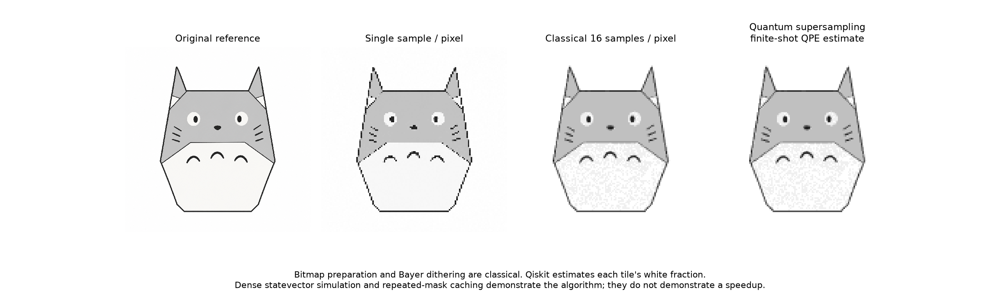

# Quantum supersampling

Estimate a pixel's brightness by counting white subpixels with quantum phase estimation. This project connects an image tile to a phase oracle, a Grover operator, and a QPE circuit.



## How the estimate works

Each output pixel contains a classical 4 by 4 bitmap tile. Four qubits encode its 16 subpixel positions. The phase oracle marks white positions, and the diffusion operator forms `Q = D @ O`.

QPE estimates the eigenphases of `Q`. Folding symmetric counter outcomes and applying a calibration lookup gives the estimated number of white subpixels. Dividing that count by 16 gives brightness.

The default example uses six counter qubits, 128 shots per pixel, and a 128 by 128 output image. Bitmap preparation, dithering, and sampling from simulator probabilities are classical operations. This is an algorithm demonstration, not a hardware experiment or a speedup benchmark.

## Read the code

Start with these functions in [quantum_supersampling.py](quantum_supersampling.py).

1. `build_phase_oracle` defines `O` from the tile.
2. `build_diffusion_operator` defines `D = 2|s><s| - I`.
3. `build_grover_operator` combines them as `Q = D @ O`.
4. `build_counting_circuit` prepares registers, controlled powers, and inverse QFT.
5. `counter_distribution` extracts counter probabilities.
6. `folded`, `calibration`, and `reconstruct` convert outcomes into an image.

The source includes Thai explanations with English quantum terminology. Download and open the [standalone HTML explanation](qss_output/quantum_supersampling_explained.html) locally for an illustrated walkthrough.

## Run the example

Run from the repository root with its virtual environment.

```powershell
.\.venv\Scripts\python.exe -m pip install -r projects/quantum-supersampling/requirements.txt
.\.venv\Scripts\python.exe -X utf8 projects/quantum-supersampling/quantum_supersampling.py --self-test
```

For a smaller trial, use `--size 8`. `-X utf8` enables circuit printing on Windows. Input and output defaults resolve relative to the script.

## Inspect the outputs

| File | Purpose |
| --- | --- |
| [comparison.png](qss_output/comparison.png) | Compare input, classical baselines, and QPE estimates. |
| [circle_notation.png](qss_output/circle_notation.png) | Connect a selected tile to its basis-state phases. |
| [qpe_circuit.png](qss_output/qpe_circuit.png) | Inspect the full quantum counting circuit. |
| [grover_circuit.png](qss_output/grover_circuit.png) | Inspect oracle followed by diffusion. |
| [inverse_qft_circuit.png](qss_output/inverse_qft_circuit.png) | Inspect the expanded inverse QFT gates. |
| [qss_totoro.png](qss_output/qss_totoro.png) | Read the output at its native resolution. |
| [metrics.json](qss_output/metrics.json) | Read parameters, self-test results, and errors. |

Circuit PNGs use Qiskit's Matplotlib drawer and `pylatexenc`. Controlled Grover powers are dense unitary blocks; pin 0 is the counter control. Measurements are added to a copy for the QPE drawing.

The saved example is 128 by 128. Absolute paths in saved metrics record the original run location and are not used to locate input files.
