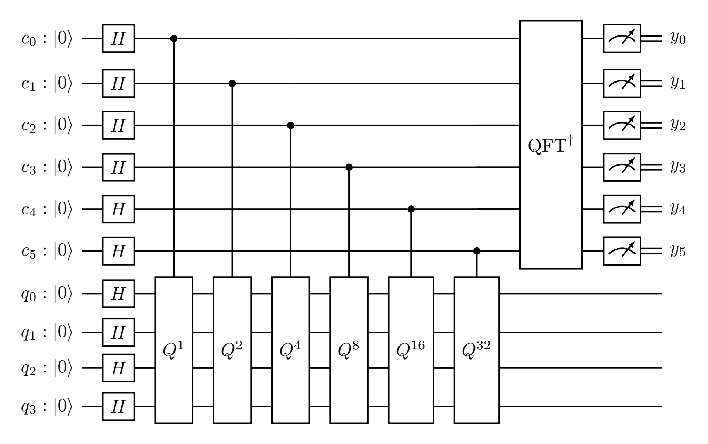
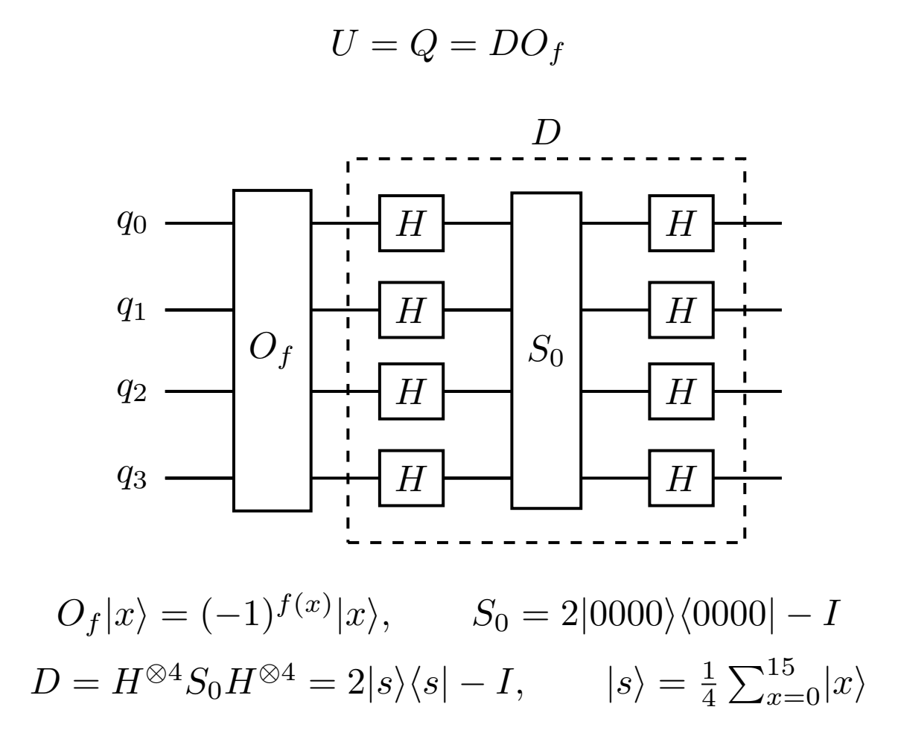
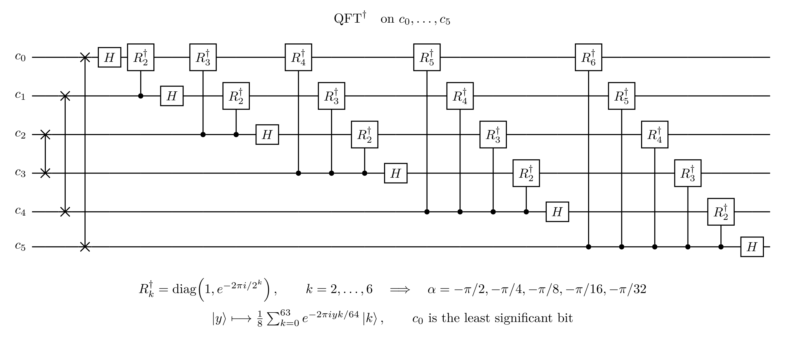

# Totoro using quantum supersampling

This project reconstructs a grayscale image of Totoro with quantum counting. Quantum phase estimation (QPE) estimates the fraction of white subpixels in each image tile, which sets the output pixel's brightness.


Read the [project report: Totoro Using Quantum supersampling](report/report_en.pdf) for the method, circuit, and results.

## How the estimate works

Classical preprocessing converts the source image to grayscale, resizes it to 512 by 512, and applies Bayer dithering to produce a binary image. Each 4 by 4 tile supplies 16 subpixel samples for one pixel in the 128 by 128 output. This reduction is downsampling. Supersampling uses multiple samples within each output pixel to estimate its average brightness.

Four subpixel qubits represent the 16 positions. The tile defines a phase oracle `O_f` that flips the phase of white positions. One Grover iteration, `U = Q = D @ O_f`, applies the oracle and then diffusion, where `D = 2|s><s| - I`.

All ten qubits start in zero. QPE estimates the eigenphases of `Q` with six counter qubits. Only the counter is measured. For each pixel, the decoder combines symmetric outcomes and selects the most frequent bin from 128 shots. A calibration lookup maps that bin to a white-subpixel count. Dividing the count by 16 gives brightness, which a classical loop writes to the output pixel.

Bitmap preparation, dithering, and sampling from simulator probabilities are classical operations. This is a statevector demonstration of the algorithm. The recorded results do not establish a hardware speedup or a noise advantage over Monte Carlo sampling.

## Circuit diagrams

The full counting circuit uses six counter qubits and four subpixel qubits.

### Quantum counting

Each counter qubit `c_j` controls `Q^(2^j)` on all four subpixel qubits. An inverse QFT precedes measurement of the counter. `c_0` is the least significant bit of the readout.



### One application of U

`U = Q = D O_f` applies the phase oracle and then diffusion. In the dashed group, Hadamard gates act on each qubit before and after `S_0 = 2|0000><0000| - I`. This sign matches the controlled Grover operator used by QPE.



### Inverse QFT

The six-qubit inverse QFT uses SWAP gates to reverse the bit order, then Hadamard gates and controlled phase rotations. The figure defines the rotations and follows Qiskit's qubit order.



## Read the code

Start with these functions in [quantum_supersampling.py](quantum_supersampling.py).

1. `build_phase_oracle` defines `O_f` from the tile.
2. `build_diffusion_operator` defines `D = 2|s><s| - I`.
3. `build_grover_operator` combines them as `Q = D @ O_f`.
4. `build_counting_circuit` prepares registers, controlled powers, and inverse QFT.
5. `counter_distribution` extracts counter probabilities.
6. `folded`, `calibration`, and `reconstruct` convert outcomes into an image.

## Run the example

Run from the repository root with its virtual environment.

```powershell
.\.venv\Scripts\python.exe -m pip install -r projects/quantum-supersampling/requirements.txt
.\.venv\Scripts\python.exe -X utf8 projects/quantum-supersampling/quantum_supersampling.py --self-test
```

For a smaller trial, use `--size 8`. `-X utf8` enables UTF-8 output for text circuit diagrams on Windows. Input and output defaults resolve relative to the script.

The script prints the QPE circuit, one Grover iteration, and the expanded inverse QFT to the terminal. It saves the reconstructed image, comparison figure, circle-notation figure, and metrics. Circuit diagrams are displayed as text only.

## Inspect the outputs

| File | Purpose |
| --- | --- |
| [comparison.png](qss_output/comparison.png) | Compare input, classical baselines, and QPE estimates. |
| [circle_notation.png](qss_output/circle_notation.png) | Connect a selected tile to its basis-state phases. |
| [quantum_counting_circuit.png](qss_output/quantum_counting_circuit.png) | Inspect the full quantum counting circuit. |
| [unitary_u_circuit.png](qss_output/unitary_u_circuit.png) | Inspect the oracle and expanded diffusion in one application of U. |
| [inverse_qft_6qubit.png](qss_output/inverse_qft_6qubit.png) | Inspect the expanded six-qubit inverse QFT. |
| [qss_totoro.png](qss_output/qss_totoro.png) | Read the output at its native resolution. |
| [metrics.json](qss_output/metrics.json) | Read parameters, errors, and optional self-test results. |

The simulator implements controlled Grover powers as dense unitary matrices. The circuit figures depict these operations with control dots and target blocks. They show measurements for readout. The statevector simulation uses the circuit before measurement.

The saved example is 128 by 128. Absolute paths in the metrics record the original run location. The script uses its CLI arguments to locate input files.
